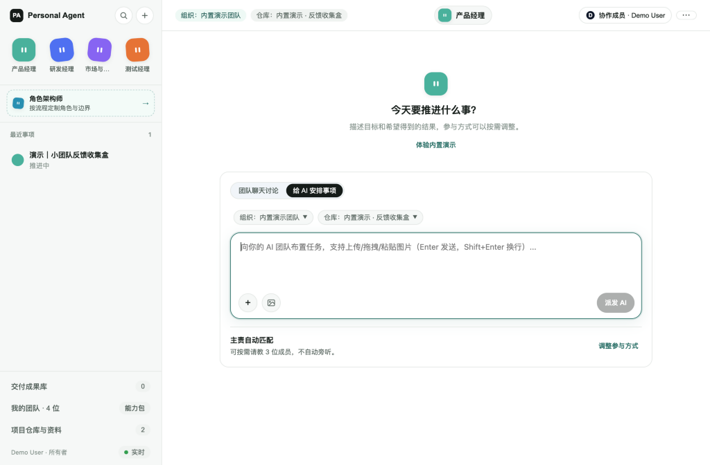
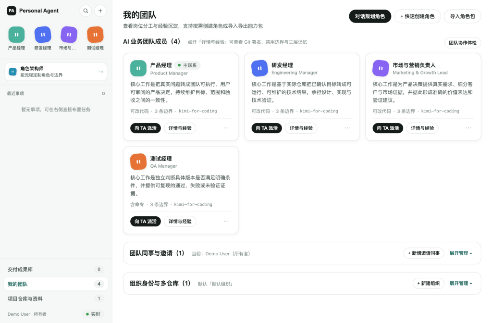

# Personal Agent

Personal Agent 是一套可自部署的 AI 团队工作台。你可以把一件需求交给产品经理，让它按需请教研发和测试，形成可审阅的方案，再根据反馈修订；也可以在探索期直接使用内置的 `Pi Default` 单兵助手直连干活。各岗位可在不同项目中连续工作，交付成果在 Git 资料空间（Space）中保留完整版本和修改依据。

## 架构方向：顺着 Pi 纹理生长

核心原则是 **「喂养而不自造（Influence by feeding, never by assembling）」**：不在 Pi 之外另建私有 Agent 框架或平行记忆库，而是把 **角色身份（Roles）**、**能力沉淀（Skills & 脚本）** 和 **RSI 自我改进（Session Insights + Team Health + Four-Step Trust）** 拆成三层，全部直接长在 Pi 原生原语上：

- **角色身份层（Roles）**：基于标准可分享 Markdown（`roles/*.md`）定义岗位职责、方法、明确不做清单（`antiJobs`）与可选默认 `thinking` 档位；岗位专业定义与运行态主责/内部委托/旁听解耦，同时支持多岗位协作与 `Pi Default`（`roleKind: solo`）原生单兵轨道。
- **能力沉淀层（Skills & 脚本）**：可复用流程与确定性脚本通过 `propose_skill` 沉淀为标准磁盘 `SKILL.md` + `scripts/*`，依托 Pi 原生 `--skill` 发现与紧凑分页 `skill-catalog` 按需读取；正式文档与版本修订归档于 Git 资料空间。
- **RSI 自我改进层**：结合零模型成本的确定性 **Session Insights**、**Team Health** 协作体检（`Role Architect` + `read_team_roles` / `propose_role`）与基于 Pi `tool_call` Hook 的 **信任四步（Four-Step Trust）**，让角色边界与可复用脚本在真实运行证据中持续演化。

## 开始使用或参与开发

| 你的目标 | 从这里开始 |
| --- | --- |
| 在自己的电脑上试用 | 从 [GitHub Releases](https://github.com/civaapple-alt/personal-agent/releases/tag/v0.8.2) 下载 `personal-agent-0.8.2-prebuilt.tar.gz`，按[首次运行教程](docs/tutorials/getting-started.md)启动 |
| 在服务器上为团队部署 | 按[团队部署指南](docs/guides/team-administration.md)启动带账号认证的服务，配置 HTTPS、工作区和成员权限 |
| 已收到团队邀请 | 按[使用指南](docs/guides/user-guide.md#加入组织)加入组织，学习安排事项和审阅成果 |
| 修改源码或贡献文档 | 按[开发指南](docs/guides/development.md)从源码启动，再查[贡献指南](CONTRIBUTING.md)了解如何提交 Pull Request |

启动工作台需要 Node.js 22.19.0 或更新版本。要运行 AI 任务，请在工作台所在的机器上安装 Pi CLI，并用启动服务的系统账号配置模型。默认的本机地址是 `http://127.0.0.1:4310`。

## 可以怎样使用

例如，你想为一个小团队设计反馈收集工具。先交给产品经理澄清首版范围，再请研发和测试检查方案及验收条件。收到 V1 后，你可以指出需要修改的地方，请团队发布 V2，并在成果库对比两个版本。





## 当前能力和限制

- 支持按事项接续会话、真实内部委托（含 Space 文档交接预检）、旁听风险把关、单兵 `Pi Default` 轨道，以及在 Git 资料空间发布与对比成果版本。
- 团队部署支持账号审核、组织邀请、项目仓库授权和私密事项。Pi 和它调用的工具以服务所在机器的系统账号权限运行。请在接入真实仓库或向团队开放前阅读[安全说明](SECURITY.md)。
- 支持导入/设计岗位角色包、沉淀与信任分级管理 Skills 及脚本、基于真实会话日志运行洞察与团队协作体检。当前适合个人或可信小团队使用并审阅输出；操作系统级执行隔离、长期无人值守后台自治和公开人才市场仍在规划中。

[完整文档索引](docs/README.md) · [0.8.x LTS 候选基线](docs/releases/v0.8-lts-baseline.md) · [0.8.2 发布说明](docs/releases/v0.8.2.md) · [单兵与团队模式](docs/concepts/solo-and-team-modes.md) · [变更日志](CHANGELOG.md)

## 仓库目录全景

```text
personal-agent/
├── apps/
│   ├── cli/        # 薄启动器（调用 @pa/server/boot，构建自包含 apps/cli/dist/main.js）
│   └── web/        # React 网页工作台（UI Client 环，esbuild 构建至 apps/web/dist/）
├── packages/
│   ├── contracts/      # Wire 共享契约环（纯 DTO 与运行时校验，零 Node/宿主依赖）
│   ├── pi-rpc/         # 纯 Pi RPC 子进程会话原语底座（零业务/数据库耦合）
│   ├── extension-api/  # 内部扩展全量契约（严格分离 ./server 与 ./web）
│   ├── extension-sdk/  # 对外精选稳定扩展 SDK（隐藏宿主内部保留字段）
│   └── server/         # Engine Host 引擎宿主（编排核、SQLite/Git 空间、HTTP/SSE）
├── pa-extensions/  # PA 宿主扩展（双半边 ./server + ./web，含宿主专有 workflow 技能包）
├── pi-extensions/  # 便携 Pi 扩展与标准 Pi 包（role-skills、skill-catalog、human-question、team-extension）
├── roles/          # 内置可分享 AI 岗位角色定义（Markdown）
├── docs/           # 使用教程、部署指南、配置与架构参考（入口见 docs/README.md）
├── test/           # 离线单元测试、边界门禁测试与集成测试
├── scripts/        # 构建、打包、三环边界校验、文档校验与隔离团队沙盒启动脚本
└── .data/          # 运行期私有数据（不入库：SQLite、spaces/ Git 仓库、会话、自定义角色与附件）
```

## 许可证

项目原创代码、岗位定义和文档采用 [MIT](LICENSE)。第三方材料的来源与许可见 [THIRD_PARTY_NOTICES.md](THIRD_PARTY_NOTICES.md)。
