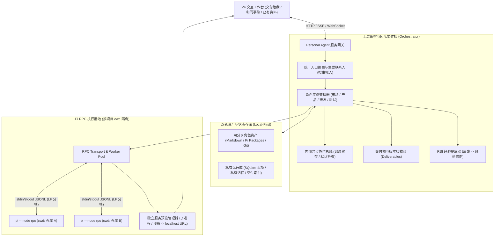
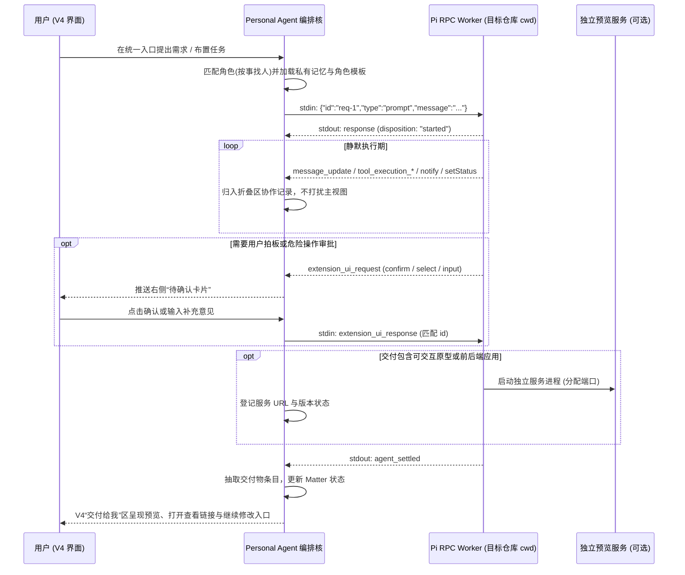

# Personal Agent 技术架构与分阶段规划

状态：初版落地文档（V1）。基于 [产品方向确认稿](product-direction.md)、[跨项目角色草案](team-roles.md)、[集中入口与团队协作](team-interaction.md)、[V4 原型记录](prototypes/v4/README.md) 以及本地 Pi 仓库（`pi-source`）的 RPC 协议规范整理。

---

## 1. 设计背景与核心目标

### 1.1 要解决的核心痛点
- **传统 Coding Agent 停留在“单项目会话”视角**：每次切换项目都要重新开 session，用户需要自己充当产品、研发、测试和市场四个角色，把各方约束拼进 prompt。
- **项目内文档无法形成“以人为本”的资产沉淀**：以往通过项目内的 `.md`、`README` 或 `ADR notes` 记录计划与决策，只能反映**单个项目**的推进轨迹，无法沉淀**跨项目角色的能力成长（RSI）**，也难以把某位同事打磨好的 AI 成员能力直接分享、复用给其他同事。

### 1.2 产品与技术对齐原则
1. **跨项目岗位稳定，项目背景按需挂载**：角色（市场与营销、产品、研发、测试）身份长期存在，干活时按目标产品和仓库加载对应上下文；**仓库自身维护的信息，以仓库为准**。
2. **自主协作、平时静默、关键时找人**：默认展示成果交付（Deliverables）和主要联系人的必要沟通，角色间内部讨论自然留存并默认折叠，遇到需用户拍板或高风险确认时再发起交互。
3. **模板与私有经验分离**：可分享的岗位能力定义（职责、技能、工具依赖、协作约定、交付验证）与入职后积累的公司/项目私有记忆解耦，支撑后续“人才市场”复用。
4. **交付不限于对话气泡**：支持文档、文件、多版本原型，以及独立运行的简单服务或前后端应用链接（V4 的 `打开查看 →`）。

---

## 2. 技术栈与 AI Core 选型结论

结合本地 Pi 生态能力，第一阶段采用 **TypeScript 全栈（Node.js 22.19+）+ `pi --mode rpc` 作为 Agent Core 执行底座**：

| 层级 | 选型方案 | 选用原因与依据 |
| --- | --- | --- |
| **运行环境与语言** | TypeScript / Node.js ≥ 22.19 | 与 Pi Monorepo 同构，前后端共享类型；Pi 要求 Node.js 22.19 或更高版本。 |
| **Agent Core（一期执行底座）** | `pi --mode rpc`（`@earendil-works/pi-coding-agent`） | 以独立子进程按项目 `cwd` 隔离执行，自带工具循环、流式事件、会话树（`fork` / `clone` / `compact`）、模型切换与 `extension_ui_request` 人机确认子协议。 |
| **上层编排与路由核** | 自研轻量 Orchestrator（后续按需引入 `@earendil-works/pi-ai` / `pi-agent-core` / `pi-durable`） | `pi --mode rpc` 是单会话、单工作区执行器；跨项目角色路由、多角色异步协作、事项与交付物归拢、RSI 记忆提炼由上层编排核统筹。 |
| **结构化状态存储** | 本地 SQLite | 保存事项（Matter）、多项目/仓库关联、角色实例私有记忆、交付物版本与预览服务状态。 |
| **可分享角色资产** | Markdown + YAML Frontmatter + Git（对齐 Pi Packages 规范） | 角色定义、Skills、Prompt Templates 与扩展落盘为纯文本，天然支持版本控制与跨团队分享。 |
| **前端工作台（V4）** | React + TypeScript（Web 优先，预留桌面端包装） | 通过 SSE / WebSocket 接收编排核推送的交付卡片状态、流式回复与审批请求。 |

> **演化预留**：Pi 仓库中的 `@earendil-works/pi-durable` 与 `@earendil-works/chord` 提供了持久对话、Task Graph 与跨进程对象运行时，但 `pi-durable` 目前明确标注为 **Experimental（API 可能随版本变更）**。一期先以稳定的 `pi --mode rpc` 跑通闭环，把业务模型沉淀在上层，后续可平滑切换或按模块引入。

---

## 3. 系统总体架构

---

## 4. 基于 Pi RPC 模式的核心机制设计

### 4.1 Worker 生命周期与隔离粒度
- **按“角色任务 + 目标工作区（`cwd`）”拉起或复用 `pi --mode rpc` 子进程**，配合 `--session-dir` 独立存放该仓库下的会话文件（或按轻量查询使用 `--no-session`），避免不同项目之间的代码上下文相互污染。
- **动态模型与推理深度调档**：上层编排核可根据任务性质调用 `set_model` 和 `set_thinking_level`——例如轻量信息梳理用高响应模型，复杂架构拆解或跨模块修改切到强推理模型。
- **运行中干预**：用户通过 V4 提出补充要求或纠偏时，编排核按目标 Worker 的当前状态选择 `steer`（当前工具执行完后立即插话改向）或 `follow_up`（当前轮收尾后继续执行），必要时发送 `clear_queue` + `abort`。

### 4.2 双轨事件消费与“静默 / 关键确认”映射
编排核持续消费 `pi --mode rpc` 的 stdout 事件流，并按以下规则分流到 V4 界面：

1. **过程静默（默认折叠）**：
   - `message_update`（`text_delta` / `thinking_delta` / `toolcall_*`）、`tool_execution_start/update/end`、`compaction_*` 以及单向 `extension_ui_request`（`notify`、`setStatus`、`setWidget`、`setTitle`）均写入该事项的内部协作与执行日志中，不在主工作区刷屏打扰用户。
2. **关键确认（阻塞卡片）**：
   - 当扩展或高风险操作触发阻塞型 `extension_ui_request`（`select`、`confirm`、`input`、`editor`）时，Pi 子进程会挂起等待。编排核将其转换为 V4 右侧“主要联系人”的待确认卡片，用户操作后再通过 stdin 回传匹配的 `extension_ui_response`（含原请求 `id`；支持 `cancelled: true`）。
3. **精准收尾判定（`agent_settled`）**：
   - `agent_end` 仅表示单次底层 run 结束（后续仍可能触发自动重试、溢出恢复、compaction 或队列续跑）。
   - 编排核必须监听 **`agent_settled`** 才判定任务真正进入空闲并触发交付物刷新；同时需检查 `prompt` 响应的 `data.disposition`——若为 `"handled"`（被扩展命令直接消费），则不会启动模型运行，不应等待 `agent_settled`。

### 4.3 协议实现上的关键工程约束
根据 Pi 仓库 [rpc.md](file://pi-source/packages/coding-agent/docs/rpc.md)、[json.md](file://pi-source/packages/coding-agent/docs/json.md) 与 [rpc-client.ts](file://pi-source/packages/coding-agent/src/modes/rpc/rpc-client.ts) 的源码细节，封装 RPC Transport 时需注意三点：
- **严禁使用 Node.js `readline` 解析 stdout**：`readline` 会把 JSON 字符串内合法的 Unicode 行/段分隔符（`U+2028`、`U+2029`）当成断行切碎 JSONL。必须使用按字节 `\n`（LF）切分的流解析器（可复用 Pi 源码中的 `attachJsonlLineReader` 思路）。
- **需自封装或扩展官方 `RpcClient`**：当前 `RpcClient` 的 `onEvent` 会转发事件，但其私有 `send()` 仅支持标准 `RpcCommandBody`，未暴露回写 `extension_ui_response` 的公开方法（参考官方示例 `packages/coding-agent/examples/rpc-extension-ui.ts`）。因此应在编排核内基于 `spawn` + LF 严格分帧封装一层支持双向 `extension_ui_response` 与背压控制的 `PiRpcWorker`。
- **Extension UI 降级边界**：RPC 模式下 `ctx.mode === "rpc"`，不支持依赖终端渲染的 `custom()` 或 `setTheme()`，所有角色插件/扩展的人机交互应收敛在 `select` / `confirm` / `input` / `editor` 与 `notify` / `setStatus` 内。

---

## 5. 一次完整协作与交付的数据流

---

## 6. 核心领域模型（面向 V4 与跨项目复用）

在 SQLite 与 Markdown 资产之间，围绕 5 个一等公民对象组织数据：

1. **RoleTemplate（可分享角色模板 — Markdown/Pi Package）**
   - 包含五维结构：职责与边界、技能与工作方法（Skills/Templates）、工具与环境依赖（MCP/CLI）、协作与沟通约定、交付与验证方式。
   - **纯通用能力，不含公司/项目敏感信息**，支持导出与同事间分享。
2. **TeamMember（角色实例 — 本地私有）**
   - 绑定某个 `RoleTemplate`，拥有持久身份（如市场与营销负责人、产品经理、研发经理、测试经理）、专属系统提示词配置、默认模型策略，以及随工作积累的**私有岗位/公司经验（Memory / RSI Notes）**。
3. **Matter（事项 / 事务主线）**
   - 不等于微信群或 Jira 工单；用于把“用户一次诉求 → 多角色异步讨论 → 跨项目影响 → 多版交付物”自然串联起来，记录当前牵头人、已知事实、待确认问题和变化原因。
4. **Deliverable（交付物）**
   - 挂在 `Matter` 下，支持类型：`document`、`artifact`、`prototype_image`、`service_url`（独立服务链接）；保留版本号（V1/V2/V3/V4）、关联提交或会话快照、以及用户的审阅反馈。
5. **WorkspaceLink & WorkerSession（项目工作区与 RPC 会话映射）**
   - 记录本地 Git 仓库路径、主分支/状态、关联的 Pi `sessionFile` 与 `sessionId`，确保后续追问、分支对比（`fork`）或接续工作时能直达原现场。

---

## 7. 分阶段落地规划路线图

### 阶段一：架构底座与 Pi RPC 闭环原型（MVP 验证）
- **目标**：不先铺重型 UI，先把最核心的“编排核调度 `pi --mode rpc` 干活并收回结构化结果”跑通。
- **关键任务**：
  1. 在 `personal-agent` 初始化 TypeScript 工程与本地包的引用验证（通过 `pi-source` 打包产物 `npm run pack:packages -- --out .artifacts/pi-packages` 或直接调用本地 `pi` CLI）。
  2. 实现 `PiRpcWorker` 封装：严格按 `\n` 拆帧的 JSONL 解析、请求 `id` 关联、`prompt` disposition 处理、`agent_settled` 等待、超时与异常退出清理，以及双向 `extension_ui_request / response`。
  3. 跑通端到端测试脚本：由一个“研发角色”接收任务 → 在目标仓库 `cwd` 拉起 `pi --mode rpc` → 拦截并响应一次 `confirm` 确认 → 等待 `agent_settled` → 输出交付摘要。

### 阶段二：四角色团队、双轨记忆与“按事找人”路由
- **目标**：建立跨项目角色体系，把团队模板与公司/项目私有经验拆开。
- **关键任务**：
  1. 落地市场与营销负责人、产品经理、研发经理、测试经理四个初始 `RoleTemplate`（Markdown 资产）及实例化管理。
  2. 搭建 SQLite 数据层，实现 `Matter`、`Deliverable`、`WorkspaceLink` 与角色私有记忆的持久化。
  3. 实现“主要联系人 / 按事找人”分派与角色间内部异步协作（角色 A 通过编排核向角色 B 发起子任务委托，内部对话落库但不主屏刷屏）。
  4. 明确“仓库事实优先”约束：涉及代码、PR、Issue、看板状态的任务统一经对应仓库的 Pi Worker 现场核查，不依赖过期摘要。

### 阶段三：V4 工作台与独立服务链接交付
- **目标**：落地 V4 概念图（[delivery-and-conversation.png](prototypes/v4/delivery-and-conversation.png)）的交互体验。
- **关键任务**：
  1. 实现 V4 三栏布局：左侧导航（`交付给我` / `和同事聊` / `已有资料` + 折叠同事列表）、中央交付主视图（预览、版本切换、`继续修改`）、右侧主要联系人对话与折叠的`协作对话`。
  2. 实现 `extension_ui_request` 到右侧“待确认卡片”的实时映射，以及运行中的 `steer` 纠偏入口。
  3. 实现独立服务预览管理器（Preview Runner）：支持由交付任务拉起本地原型/前后端预览服务，管理端口与启停，在交付卡片提供可点击的 `打开查看 →` 链接。

### 阶段四：RSI 持续成长与“人才市场”能力分享
- **目标**：解决“跨同事、跨角色共享与共同进化”的核心愿景。
- **关键任务**：
  1. 建立 **RSI 闭环流水线**：每次交付完成或收到用户修改反馈后，后台异步提炼“经验候选条目”（区分**具体项目事实** vs **通用岗位方法**），经确认或验证后更新对应文档/Skill。
  2. 接入评估基线（参考 Pi `packages/evals` 与 `@earendil-works/pi-telemetry`）：检验某条新沉淀的技能是否真正减少了后续任务中的同类遗漏。
  3. 实现角色能力包的**导出与导入**（对齐 Pi Packages 结构）：支持将脱敏后的岗位职责、Skills 与扩展打包分享给同事，同时保证本地公司/项目私有记忆不泄露。

---

## 8. 风险边界与待拍板工程项

1. **命令与文件权限隔离**：Pi 文档明确指出其默认不限制文件系统、进程和网络权限，按启动进程权限运行。前期本地个人使用可直接运行；若需让角色自动执行高风险测试或对外启动预览服务，需按 [containerization.md](file://pi-source/packages/coding-agent/docs/containerization.md) 接入 Docker 或 Gondolin micro-VM 隔离。
2. **下一轮开启编码前需确认的两项工程细节**：
   - **代码工程形态**：是在当前仓库直接新建 `packages/`（或 `src/` + `web/`）作为一体化 TypeScript 工程，还是先建 `server/`（编排核）+ 独立前端目录？
   - **本地 Pi 执行方式**：第一期是直接调用机器上已构建/安装的 `pi` CLI，还是将 `pi-source` 打包产物集成进本仓库依赖？
