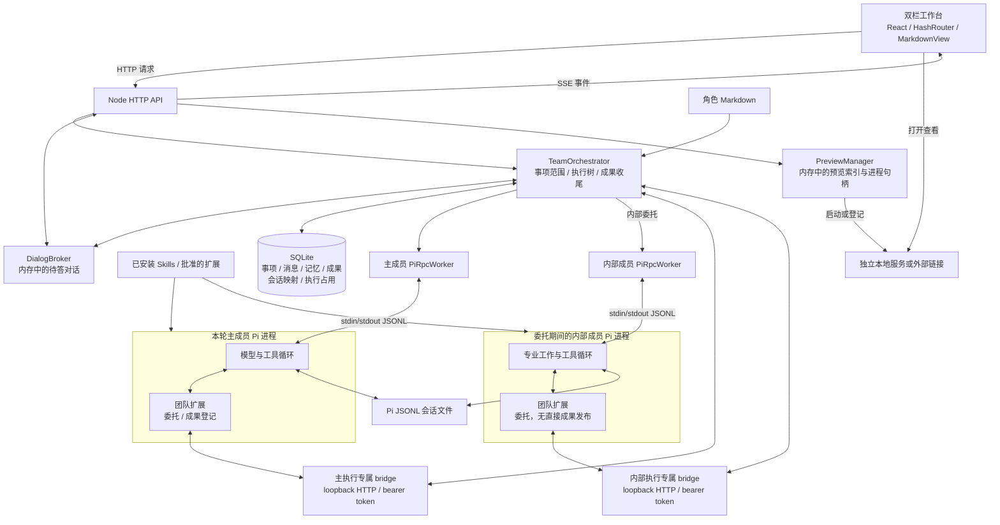
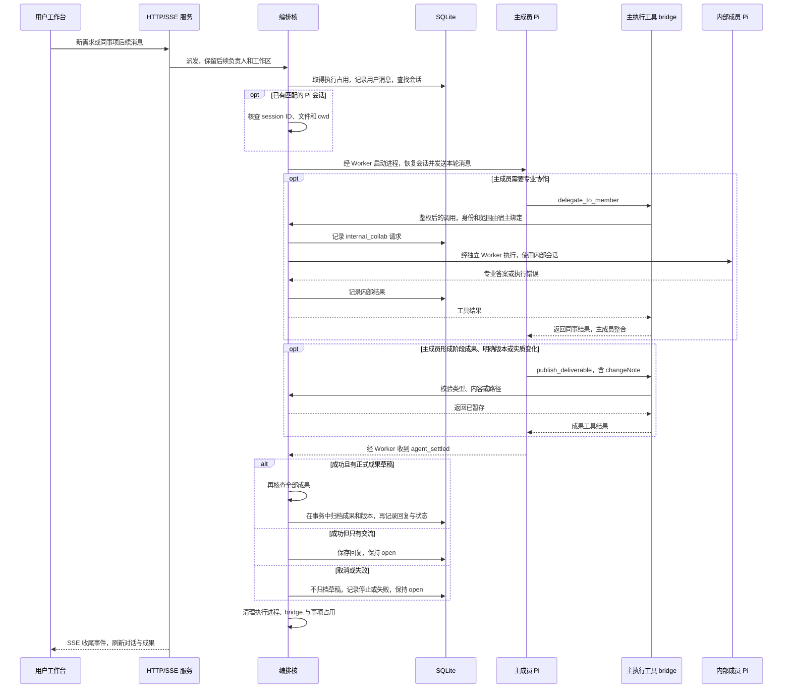

# Personal Agent 当前架构与后续计划

状态：2026-11-15 按当前源码核对，代码基线为 `54fcbcc`，产品说明基线为 `ee79e90`。本文说明模块关系、当前实现范围和下一阶段计划；协议细节、迁移规则与实机证据见[连续上下文与内部角色协作](runtime-collaboration.md)。

## 1. 产品目标与实现边界

Personal Agent 是为用户跨项目工作的轻量 AI 岗位团队。成员保持相对稳定的职责，按需协作，用户主要参与必要交流、查看成果并给出反馈。初始四个岗位是示例，团队可通过新增、导入不同角色定义组合。系统不要求用户维护 Jira 式流程、为每件事建群或定期手工整理周报。

当前已实现本机工作台、角色定义管理、工作区关联、持久会话接续、真实工具驱动的内部委托，以及显式成果归档。这里的“自主”指成员在一轮任务内自行使用工具、委托同事并整合结果；它不代表已有跨重启自动运行的后台任务系统，也不代表完整岗位能力和长期成长已验证。

产品依据见[产品方向确认稿](product-direction.md)与[产品讨论记录](product-discussion.md)。本轮实现不涉及书架业务，书架只是此前网页试用的背景项目。

## 2. 当前技术栈与进程结构

| 层级 | 当前实现 | 明确范围 |
| --- | --- | --- |
| 运行与语言 | Node.js ≥ 22.19、严格 TypeScript | `src/` 可由 Node 原生运行，也可通过 `tsc` 编译到 `dist/` |
| 前端 | React、esbuild、原生 CSS | 双栏工作台，使用 `HashRouter`、`MarkdownView`；未集成早期设想的 Pi UI 组件或 Mermaid 消息渲染 |
| 用户通信 | Node HTTP API 与 SSE | HTTP 发起消息、停止和配置操作；SSE 推送文本、进度、对话卡片和收尾事件；没有 WebSocket |
| 编排 | `TeamOrchestrator` | 负责事项范围、成员选择、执行所有权、委托树及成果收尾 |
| 执行 | 本机 `pi --mode rpc` | 每次主成员或内部成员执行均启动独立 Pi 进程，结束后退出；会话通过确切文件恢复，没有驻留 Worker 池 |
| 模型工具桥接 | Pi 扩展与每个执行专属的 loopback HTTP bridge | 扩展向模型注册团队工具，bridge 校验 bearer token 并把调用交给编排核 |
| 持久状态 | `node:sqlite` 与 Pi JSONL 会话文件 | SQLite 保存领域记录、会话映射和事项执行占用；模型历史在 Pi 会话文件中 |
| 角色与 Skills | Markdown 定义与实际 `SKILL.md` 文件 | 定义可导入导出；依赖需要已安装，导入不会自动安装 Skills、扩展或 MCP 服务 |
| 服务预览 | `PreviewManager` 与预览 HTTP API | 启停本地服务或登记外部链接；预览索引和进程句柄在服务内存中，不是持久部署记录 |
| 工程验证 | Biome、`tsc`、`node:test` | 构建、代码检查、回归和隔离实机脚本各有独立入口 |

Pi 验证版本为 1.5.2。成员的 provider、model 和 thinking level 来自成员配置，启动时应用；当前没有根据任务复杂度自动选择或调档模型的策略。RPC 封装中存在的方法也不等于网页已提供对应操作。

### 当前架构图

图中的每个 Pi 执行拥有自己的 Worker、bridge、身份与取消信号。内部成员可以在边界内继续委托；上图只展开一层。角色、SQLite、Pi 会话文件和预览进程承担不同责任，不能用其中一项的存在推断其他部分已经完成工作。

## 3. 模块与数据的所有权

| 源码入口 | 负责的事实与行为 |
| --- | --- |
| [`src/server/app.ts`](../src/server/app.ts)、[`main.ts`](../src/server/main.ts) | HTTP/SSE、异步派发、用户对话与服务退出顺序 |
| [`team-orchestrator.ts`](../src/orchestrator/team-orchestrator.ts) | 新事项路由、后续负责人、工作区、运行树、内部委托与归档决定 |
| [`execution-context.ts`](../src/orchestrator/execution-context.ts) | Skill 路径解析、保存会话身份和路径核查、文件及链接成果校验 |
| [`team-extension.ts`](../src/rpc/team-extension.ts) | Pi 内团队工具注册、实际工具清单装配、当前岗位系统上下文 |
| [`team-tool-bridge.ts`](../src/rpc/team-tool-bridge.ts) | bridge 鉴权、请求解析、调用 ID 去重、连接取消和清理 |
| [`pi-rpc-worker.ts`](../src/rpc/pi-rpc-worker.ts)、[`jsonl.ts`](../src/rpc/jsonl.ts) | 子进程、LF 分帧 RPC、确切 session 参数、事件、对话回写与 settled 等待 |
| [`storage/`](../src/storage/) | SQLite 模式、领域记录、批量成果事务与单机事项执行占用 |
| [`dialog-broker.ts`](../src/server/dialog-broker.ts)、[`preview-manager.ts`](../src/server/preview-manager.ts) | 分别管理内存中的待答对话和预览服务，不是持久后台调度器 |

### 领域模型与当前范围

| 对象 | 当前存储与关系 | 尚不包含的能力 |
| --- | --- | --- |
| `RoleTemplate` | Markdown 定义职责、方法、工具依赖、协作和验证约定，可导入导出 | 公开市场、自动依赖安装、分享内容的自动脱敏审计 |
| `TeamMember` | SQLite 中的稳定成员 ID、角色定义关联、模型配置和主要联系人标记 | 完整入职生命周期；当前模板同步为同 ID 成员，多个独立实例需使用不同角色 ID |
| `MemberMemory` | 成员经验及来源事项，范围为 `role_general`、`company_private`、`project_private` | 自动经验提炼、学习成效评估和组织级授权共享 |
| `Matter` | 事项标题、摘要、当前负责人、当前工作区与状态，用来承接交流和成果 | 跨项目任务图、持久任务队列；它不要求用户人工维护研发工单 |
| `MatterMessage` | `user`、`internal_collab`、`notice` 三个通道及可选元数据 | 完整逐事件审计库；并非每个 Pi 流式事件都落入 SQLite |
| `Deliverable` | 所属事项、发布成员、类型、正文或路径、链接、版本及反馈 | 自动业务验收、统一文件托管、自动绑定 Git 提交或会话快照 |
| `WorkspaceLink` | 工作区 ID、仓库路径、默认分支等登记信息 | 公司身份、动态 Git 状态快照或自动工作树管理 |
| `WorkerSession` | 事项、成员、工作区、Pi session ID/文件、上下文键及消息游标 | 常驻进程；`active` 状态记录本身不能证明宿主仍存活 |
| 事项执行占用 | SQLite 的 `matter_execution_leases` 保存宿主 PID 与占用者 ID | 分布式租约、对 PID 复用的防护 |

### 经验、历史与运行状态

`role_general` 是可供该成员跨工作区使用的岗位经验，但仍属于本地私有运行数据，不会随角色 Markdown 导出。公司与项目私有记忆只有明确绑定当前工作区时才自动注入；无工作区的旧私有记忆保留供查看，不作为全局背景。系统还不能识别两个工作区是否属于同一组织。

岗位约定要求以目标仓库事实为准。记忆的范围筛选和 `verified` 标记不等于事实自动保持最新，也没有后台学习流水线。会话映射用于找到 Pi 历史，运行表用于控制当前执行，待发布草稿用于本轮收尾；后三者不能互相替代。迁移和有界历史补充的细节见[会话范围与接续](runtime-collaboration.md#会话范围与接续)。

## 4. 一轮交流、内部协作与成果的数据流

1. HTTP 接收请求。新事项优先使用显式成员，否则按关键词初始路由，未命中时使用主要联系人；后续消息默认保留事项负责人和工作区，除非明确变更。
2. 编排核取得事项执行占用，记录带工作区范围的用户消息。已有同事项执行时拒绝重叠消息或工作区切换，HTTP 返回 409。
3. 执行范围由事项、成员、工作区 ID、绝对路径和用户/内部模式共同确定。找到历史映射时校验 Pi 文件首行的 session ID 与真实 `cwd`，再用确切 `--session` 路径启动；没有映射才建立新会话。
4. 显式加载角色 Skills、团队扩展和批准的扩展，核查实际注册的普通工具及 MCP 依赖。当前岗位五段定义、适用私有记忆和团队信息进入系统上下文。主要历史由 Pi 原生会话承接，宿主只补充有界的新交流。
5. 主成员需要其他岗位工作时调用 `delegate_to_member`。bridge 将调用交给编排核，宿主绑定成员身份、事项、工作区和调用链，启动或恢复内部成员的独立会话。内部结果或错误作为工具结果回到调用者，由主成员整合。
6. 主成员判断是否形成正式成果。过程回复、需求澄清和细小讨论调整只保留对话；可审阅阶段成果、明确版本或实质变化才调用 `publish_deliverable`，提供正文/路径/链接及 `changeNote`。内部成员没有直接发布工具，宿主同样拒绝其伪造发布请求。
7. 成果先暂存。正常模型执行等待 `agent_settled` 后，再核查整轮是否成功、是否取消以及全部成果文件是否有效。成功且有草稿时才事务写入成果版本；没有草稿只保存回复。停止或失败不归档本轮草稿，清理 Pi 进程、bridge 和执行占用。

`agent_settled` 是本轮执行收尾信号，不是交付信号。若 Pi 返回 `prompt` 的 `disposition: handled`，则立即结束该次等待，不等待不会出现的 settled。成果批量写入拥有自己的 SQLite 事务，回复和事项状态在其后记录，当前并没有覆盖所有外部动作与整个收尾过程的统一事务。

### 用户通信与过程留存

主成员正文通过 SSE 流向当前对话，内部成员不向用户频道流式输出。内部请求、答案和错误留在 `internal_collab`，工具开始/结束事件、能力清单与扩展 notices 留在 `notice`，供用户按需查看。主工作区不默认展开细碎内部过程，也不声称已经持久化每个 thinking delta 或 compaction 事件。

扩展发出 `select`、`confirm`、`input`、`editor` 对话时，`DialogBroker` 通过 HTTP/SSE 等待用户答复，再由 Worker 回写 `extension_ui_response`。这是已实现的人机交互桥接，不是对所有 bash 命令或危险操作的通用权限拦截器。

## 5. 当前可靠性与权限边界

| 场景 | 当前行为与限制 |
| --- | --- |
| 后续交流或宿主重启 | 下一条用户消息显式接续确切会话；不自动继续未完成的动作，也不从目录选择“最近会话” |
| 会话缺失、损坏或路径不符 | 明确失败，不静默开空会话；旧版每轮新建会话造成的完整历史无法无损重建 |
| 工作区切换 | 空闲时可切换；新范围使用另一会话，切回原范围可恢复原会话。运行中切换返回 409 |
| 并发 | 同事项由运行表和 SQLite 占用限制为一轮；不同事项可并行；同委托树中忙碌的同范围成员返回工具错误 |
| 停止与失败 | 取消传给主执行、内部成员和工具连接；启动失败、模型错误及超时均清理。服务退出先停止接收请求，再清理执行树并关闭数据库 |
| 网页运行中纠偏 | 当前只有停止后发新消息；底层 `steer`、`follow_up` 等封装不构成已实现的网页 steer 或自动插话策略 |
| 委托边界 | 防止自身/祖先循环，限制深度与每轮数量，复用同轮相同委托；具体数值及错误约定见[运行说明](runtime-collaboration.md#并发失败与停止) |
| 崩溃与去重 | 去重限于本轮内存；PID 占用用于单机防并发，不是跨崩溃 exactly-once。已写文件和外部操作不会因取消自动回滚 |
| 扩展与 MCP | 按工具声明和批准的扩展核查实际清单，MCP 沿用已有 Pi 配置；未实现自动安装，外部 MCP 尚无本轮实机验证 |
| 执行权限 | `cwd`、上下文范围和 bridge 鉴权不是操作系统沙箱。Pi 以本机用户权限运行，没有容器隔离或组织级安全边界 |

### 成果与独立服务

`document` 保存正式正文，文件类成果必须是当前工作区内的实际文件，`service_url` 仅接受 HTTP(S) 链接。`changeNote` 保存进成果摘要，主成员回复元数据关联成果 ID 与来源用户消息；相同事项与标题形成版本系列。是否达到阶段成果由主成员依据任务和反馈判断，不按回复长短、对话轮数判断，也不要求用户逐次手动批准归档。

`delivered` 表示本轮正式成果已归档，不代表用户已验收；普通交流、取消或失败保持 `open`。API 显式提供 `deliverableTitle` 的文档导出兼容入口仍存在，网页已移除“修改”前缀自动导出逻辑。详见[成果归档](runtime-collaboration.md#成果归档)。

预览 API 可让 `PreviewManager` 启动并停止本地命令，或登记外部链接，可关联交付 ID。它不由 `publish_deliverable` 自动创建服务，也不自动部署。链接语法有效、已登记、甚至本地端口可连接，都不等于页面可用或业务通过验收；预览运行索引不会随宿主重启恢复。

## 6. 已实现基础与下一阶段计划

### 已实现范围

| 工作面 | 已有基础 | 验证边界 |
| --- | --- | --- |
| Pi 执行与工作台 | RPC、HTTP/SSE、双栏界面、对话、停止、反馈与预览 API | 已有回归和源码/构建入口启动验证；不是持久后台运行系统 |
| 上下文与协作 | 按范围恢复会话、真实委托工具、内部通道、取消与执行占用 | 最小真实 Pi 场景覆盖产品经理咨询研发、跨宿主接续；不代表所有岗位或多日可靠性已验证 |
| 成果记录 | 显式阶段发布、变化依据、版本和反馈 | 连续过程交流不新增交付，随后明确发布一个 V1；质量仍需具体任务证据与用户判断 |
| 角色复用 | Markdown 导入导出、不同角色 ID 组建团队、实际 Skill 装载与依赖核查 | 不是公开人才市场，也没有自动依赖安装或自动学习 |

早期四阶段路线已产出上述基础，不能再把整个阶段二、三视为纯待办，也不能把基础导入导出等同于整个阶段四完成。下列顺序是后续工程建议，不是已实现承诺或本次功能范围。

### 下一阶段：检验日常协作和交付判断

优先积累有界、可重复的真实任务证据，覆盖模糊需求澄清、多人意见整合、连续修订和失败后接续。检查交付是否达到可审阅阶段、变化依据是否准确，以及是否出现不必要的用户打扰。先让已有流程在更多真实场景中可靠，再扩展自动化范围。

后续可完善损坏/丢失会话的明确恢复入口、成果与文件/服务状态的一致性、预览重启策略，以及针对实际外部工具配置的能力验证。每项应由具体问题、可观察结果和回归证据驱动，不引入用户维护的重型工作流。

### 后续独立设计项

| 方向 | 尚缺的关键设计与验证 |
| --- | --- |
| 持久后台任务与多日自主工作 | 持久任务状态、唤醒、恢复、取消、重试和外部动作去重，持续运行的资源与失败观测 |
| 组织身份与跨项目经验 | 公司/组织标识、成员与工作区的授权关系、哪些经验可以在同组织多个工作区共享 |
| RSI 持续成长 | 从工作与反馈提炼候选经验、区分项目事实和通用方法、验证后更新，再评估后续任务是否真正改善 |
| 完整人才市场 | 角色定义与成员私有背景的分享边界、可验证的包与依赖、安装/升级和发布机制；当前导入导出只是基础 |
| 权限与运行环境 | 按实际使用风险设计命令授权和隔离环境，不能把本机 `cwd` 当作沙箱 |

上述方向尚未完成，持续成长也不能由一次测试通过或一份 `SKILL.md` 的存在证明。

## 7. 核对方式与演进记录

本次文档同步核对了编排入口、RPC/扩展桥接、SQLite 模式、记忆筛选、预览管理与网页路由源码。未修改代码，未为文档改写重跑整套代码测试或真实模型调用；链接、Mermaid 与源码一致性另行检查。

已有工程基线为 `npm run check`、32 项 `npm test`、构建及 `npm run check:startup` 通过。最小实机证据是主成员实际调用委托工具、三轮同 Pi session、前两轮过程交流零交付、重启宿主后实际发布一个 document V1，结束无残留执行占用。复现入口与限制集中在[可重复验证](runtime-collaboration.md#可重复验证)。

原始开发前架构保存在 Git 提交 `a91c1cf`，可用 `git show a91c1cf:docs/architecture-and-plan.md` 查阅。当前文档只描述现状和明确标注的后续计划。[V1–V4 原型与反馈](prototypes/README.md)保持原样，继续作为产品演进历史。
