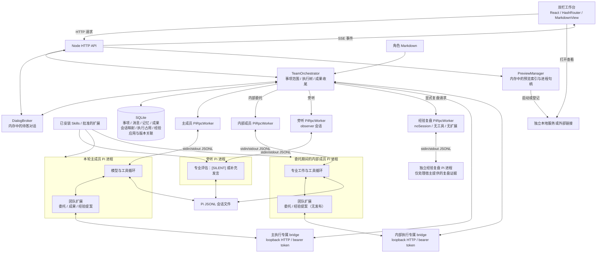
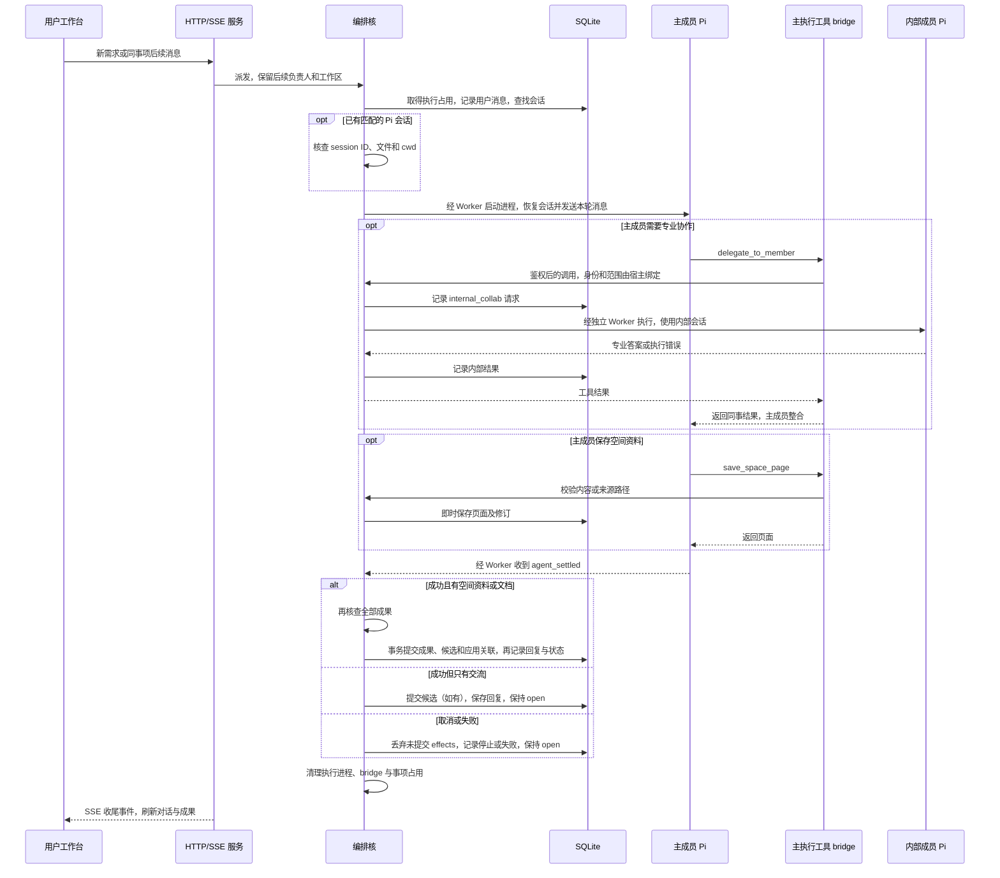

# Personal Agent 当前架构与后续计划

供贡献者和维护者查阅工作台、编排器、Pi Worker 与存储之间的关系，以及当前实现和后续计划。具体运行契约见[会话与协作参考](../reference/runtime-collaboration.md)，历史基线见[架构演进记录](../history/architecture-history.md)。

## 1. 产品目标与实现边界

产品的使用方式和设计取舍见[设计思路](design-principles.md)。运行和网络约束见[安全说明](../../SECURITY.md)。

产品定位与使用方式：

- Personal Agent 是为用户跨项目工作的轻量 AI 岗位团队。
- 成员保持相对稳定的职责，按需协作，用户主要参与必要交流、查看成果并给出反馈。
- 初始四个岗位（`roles/`）是示例，团队可通过新增、导入不同角色定义组合。
- 系统不要求用户维护 Jira 式流程、为每件事建群或定期手工整理周报。

当前已实现范围与边界：

- 已实现本机工作台、角色定义管理、工作区关联、持久会话接续、会议室旁听列席、真实工具驱动的内部委托、显式成果归档与清晰阅读视图，以及 RSI 多角色候选经验提炼、人工核验、替代与应用记录的基础链路。
- 这里的“自主”指成员在一轮任务内自行使用工具、委托同事并整合结果，并在中断后可按快照简报续接；不代表已有跨重启自动运行的定时后台任务系统，也不代表完整岗位能力与无人值守长期演进已验证。
- 产品依据见[产品方向确认稿](product-direction.md)与[产品讨论记录](../history/product-discussion.md)。本轮实现不涉及先前试用的业务项目，该项目只作为网页体验背景。

角色与可分发能力包的设计边界见[设计思路](design-principles.md)。当前可显式装载角色声明的 Skill，并通过配置的 pstack 方法源按需读取模式与原则；尚未实现完整第三方插件导入、版本依赖解析或跨宿主子代理/hooks 适配。

## 2. 当前技术栈与进程结构

Personal Agent 采用**三环硬边界多包架构**（由 [check-module-boundaries.mjs](../../scripts/check-module-boundaries.mjs) 在 `npm run check` 中强制校验）与**双半边扩展体系**：

- **三环解耦与薄入口（`apps/` + `packages/`）**：
  - **Engine Host（[`packages/server`](../../packages/server/src/README.md)）**：可嵌入的引擎宿主库，导出 `bootHost()` 与全部后端能力；
  - **Pi RPC 会话原语底座（[`packages/pi-rpc`](../../packages/pi-rpc/README.md)）**：纯 Pi RPC 子进程生命周期与 JSONL 协议原语，与上层团队工具和业务编排解耦；
  - **The Wire（[`packages/contracts`](../../packages/contracts/README.md)）**：零 `node:*` / React 依赖的共享契约层，是前后端之间唯一允许共享的协议边；
  - **内部契约与外部 SDK 分层（[`packages/extension-api`](../../packages/extension-api/README.md) / [`packages/extension-sdk`](../../packages/extension-sdk/README.md)）**：内部全量契约供内置扩展使用，对外 SDK 仅暴露精选稳定安全子集并校验版本；
  - **UI Client（[`apps/web`](../../apps/web/README.md)）**：纯浏览器端 React 工作台，只依赖 `@pa/contracts`、`@pa/extension-api/web` 与 `@pa/ext-*/web`；
  - **薄启动器（[`apps/cli`](../../apps/cli/README.md)）**：仅做参数/信号处理并调用 `@pa/server/boot`，构建为无 `node_modules` 依赖的自包含 `apps/cli/dist/main.js`，为后续多入口（桌面壳、远程端、IM 网关）保持同一宿主路径。
- **双半边扩展与原生 Pi 复用（`pi-extensions/` + `pa-extensions/`）**：
  - **[`pi-extensions/`](../../pi-extensions/README.md)**：便携 Pi 扩展与标准 Pi 包（如 `role-skills`、`skill-catalog`、`human-question`），不依赖 `@pa/*` 宿主包，可在原生 `pi` 终端独立使用；
  - **[`pa-extensions/`](../../pa-extensions/README.md)**：PA 宿主扩展包（`@pa/ext-*`），每个包严格分为互不导入的 `./server`（通过 `@pa/extension-api/server` 组合内置 Pi 扩展或原生第三方 Pi 包如 `pi-web-access`）与 `./web`（通过 `@pa/extension-api/web` 注册前端工具展示元数据），分别由 [server/extensions/registry.ts](../../packages/server/src/extensions/registry.ts) 与 [web/src/extensions/registry.ts](../../apps/web/src/extensions/registry.ts) 静态装配。
- **三条运行铁律**：
  1. **坚持 Pi RPC 子进程**：所有岗位、内部协作者、旁听与经验复盘均通过独立 `pi --mode rpc` 子进程执行，保留多租户与并发隔离，不耦合 Pi 私有内部符号；
  2. **喂养而不自造（Influence by feeding, never by assembling）**：模型目录、认证、Compaction、Skill 发现与加载、Session JSONL 均交由原生 Pi 托管，PA 只做岗位权限裁剪、组织/工作区边界与跨岗编排；
  3. **直接复用原生 Pi 生态包**：如 `pi-web-access` 直接以标准 Pi 包接入，由 PA 宿主扩展薄包装治理凭据与展示，不重复造轮子。

| 层级 | 当前实现 | 明确范围 |
| --- | --- | --- |
| 运行与语言 | Node.js ≥ 22.19、严格 TypeScript、npm workspaces | `apps/cli/src/main.ts` 可由 Node 原生运行，也可通过 `npm run build:cli` 打包为自包含 `apps/cli/dist/main.js` |
| 前端 | React、esbuild、原生 CSS | 双栏工作台，使用 `HashRouter`、`MarkdownView`；含「团队委托 / 过程事件 / 经验复盘」浮层、进度快照卡片与「本版重点 + 过程脉络」精简成果视图；未集成早期设想的 Pi UI 组件或 Mermaid 消息渲染 |
| 用户通信 | Node HTTP API 与 SSE | HTTP 发起消息、停止（含运行停止与提炼取消）、旁听调整和配置操作；SSE 推送文本、进度、对话卡片、旁听插话与收尾事件；`GET /api/bootstrap` 与 `/api/matters/:id` 附带进行中运行快照以支持刷新恢复；没有 WebSocket |
| 编排 | `TeamOrchestrator` | 负责事项范围、成员选择、执行所有权、委托树、会议旁听评估、只读经验复盘及成果收尾 |
| 执行 | 本机 `pi --mode rpc` | 主成员、内部成员、旁听评估及无工具只读经验复盘均按需启动独立 Pi 进程；主/内/旁听会话通过确切 `--session` 恢复，经验复盘使用 `noSession: true` 无工具执行 |
| 模型工具桥接 | Pi 扩展与每个执行专属的 loopback HTTP bridge | 扩展向模型注册团队工具，bridge 校验 bearer token 并把调用交给编排核 |
| 持久状态 | `node:sqlite` 与 Pi JSONL 会话文件 | SQLite 保存领域记录、会话映射和事项执行占用；模型历史在 Pi 会话文件中 |
| 角色与 Skills | Markdown 定义与实际 `SKILL.md` 文件 | 定义可导入导出；依赖需要已安装，导入不会自动安装 Skills、扩展或 MCP 服务 |
| 服务预览 | `PreviewManager` 与预览 HTTP API | 启停本地服务或登记外部链接；预览索引和进程句柄在服务内存中，不是持久部署记录 |
| 工程验证 | Biome、`tsc`、`node:test` | 构建、代码检查、回归和隔离实机脚本各有独立入口 |

Pi 验证版本为 1.5.2。模型按事项主责、组织岗位、平台默认及 Pi 默认的顺序选择；当前没有根据任务复杂度自动选择或调档模型的策略。RPC 封装中存在的方法也不等于网页已提供对应操作。

### 当前架构图

图中执行单元与状态边界如下：

- 每个 Pi 执行拥有自己的 Worker、身份、取消信号与（若启用的）bridge。
- 内部成员可以在边界内继续委托（不具备发布成果权限）。
- 旁听成员在 `observer` 作用域会话中禁用委托、发布与经验提案，但仍按角色装载允许的基础工具和 Skills，仅在需要风险补充时直接向用户发言。
- AI 经验复盘采用无工具、无扩展的只读 `noSession` 执行并可随时取消。
- 角色、SQLite、Pi 会话文件和预览进程承担不同责任，不能用其中一项的存在推断其他部分已经完成工作。

## 3. 模块与数据的所有权

| 源码入口 | 负责的事实与行为 |
| --- | --- |
| [`src/server/app.ts`](../../packages/server/src/server/app.ts)、[`main.ts`](../../apps/cli/src/main.ts) | 装配服务与退出顺序；鉴权、SSE、上传、派发及路由分别由 [auth](../../packages/server/src/server/auth.ts)、[sse](../../packages/server/src/server/sse.ts)、[uploads](../../packages/server/src/server/uploads.ts)、[dispatch-runner](../../packages/server/src/server/dispatch-runner.ts) 与 [业务路由](../../packages/server/src/server/README.md#业务路由) 维护 |
| [`team-orchestrator.ts`](../../packages/server/src/orchestrator/team-orchestrator.ts) | 装配事项执行，管理运行、中止及退出。[matter-dispatch](../../packages/server/src/orchestrator/execution/matter-dispatch.ts) 持有单轮执行占用并处理消息、回复与成果收尾。[worker-runner](../../packages/server/src/orchestrator/execution/worker-runner.ts)、[delegation-runner](../../packages/server/src/orchestrator/execution/delegation-runner.ts)、[observer-runner](../../packages/server/src/orchestrator/execution/observer-runner.ts)、[distiller](../../packages/server/src/orchestrator/rsi/distiller.ts) 分别拥有执行、委托、旁听与复盘路径 |
| [`matter-initiation.ts`](../../packages/server/src/orchestrator/architect/matter-initiation.ts)、[`pi-decision.ts`](../../packages/server/src/orchestrator/architect/pi-decision.ts)、[`meta-architect.ts`](../../packages/server/src/orchestrator/architect/meta-architect.ts)、[`role-architect.ts`](../../packages/server/src/roles/role-architect.ts) | 立项适配评估与职责缺口诊断（实时本地规则 + 类型化 Pi LLM 决策模型 `runTypedPiDecision`）；无工具只读 Meta-Bot 角色架构师（按工作流建队、团队协作体检与事项中途介入补人提案）；离线规则快速角色设计 |
| [`execution-context.ts`](../../packages/server/src/orchestrator/execution/execution-context.ts)、[`matter-context.ts`](../../packages/server/src/orchestrator/runtime/matter-context.ts) | 前者处理 Skill/会话/成果文件校验；后者按组织、工作区和路径筛选证据及有来源关联的成果，供旁听与复盘使用 |
| [`team-extension.ts`](../../pi-extensions/team-extension/index.ts) | Pi 内团队工具注册、实际工具清单装配、当前岗位系统上下文 |
| [`team-tool-bridge.ts`](../../packages/server/src/rpc/team-tool-bridge.ts) | bridge 鉴权、请求解析、调用 ID 去重、连接取消和清理 |
| [`pi-rpc-worker.ts`](../../packages/server/src/rpc/pi-rpc-worker.ts)、[`jsonl.ts`](../../packages/server/src/rpc/jsonl.ts) | 子进程、LF 分帧 RPC、确切 session 参数、事件、对话回写与 settled 等待 |
| [`storage/`](../../packages/server/src/storage) | `PersonalAgentStore` 门面委托各域 [repos](../../packages/server/src/storage/repos/matter-repo.ts)，拥有记录、事务、提请原子状态转换与单机执行占用 |
| [`dialog-broker.ts`](../../packages/server/src/server/dialog-broker.ts)、[`preview-manager.ts`](../../packages/server/src/server/preview-manager.ts) | 分别管理内存中的待答对话和预览服务，不是持久后台调度器 |

### 目录组织与源文件行数

后端沿 HTTP、编排、数据与 Pi RPC 分层。HTTP 层校验请求和访问范围，编排层负责一次执行及协作，存储层维护事务和记录，RPC 层处理 Pi 进程和协议。网页保留页面入口和共用组件，按业务拆分 HTTP 请求与 DTO，按交互范围维护会话、草稿和页面数据。具体入口见[后端源码地图](../../packages/server/src/README.md)和[前端状态与组件](../../apps/web/src/README.md)。

统计范围为 `src/` 和 `web/` 的 TypeScript、JavaScript、CSS 和 HTML 源文件。计入注释与空行，排除文档、依赖和构建产物。下表比较重构前的 `ab40a07` 与重构完成时的 `1a0c04d`。

| 目录 | 文件数（调整前 → 调整后） | 总行数 | ≥500 行 | ≥1,000 行 |
| --- | ---: | ---: | ---: | ---: |
| `src/` | 86 → 93 | 24,942 → 25,073 | 16 → 16 | 3 → 0 |
| `web/` | 59 → 79 | 26,293 → 26,618 | 22 → 21 | 4 → 0 |
| 合计 | 145 → 172 | 51,235 → 51,691 | 38 → 37 | 7 → 0 |

| 原入口 | 调整前 | 调整后 |
| --- | ---: | --- |
| 网页根组件 | 1,659 | [App.tsx](../../apps/web/src/App.tsx) 966 行，移出认证、邀请、事项范围、草稿及面板数据 |
| 网页 API | 1,570 | [api.ts](../../apps/web/src/api.ts) 11 行，业务模块最大 402 行 |
| 视图样式 | 1,455 | 团队、角色架构师、设置、账号与管理样式，最大为 [role-architect.css](../../apps/web/src/styles/role-architect.css) 551 行 |
| 团队与记忆路由 | 1,417 | 团队成员、角色包、角色设计与经验路由，最大为 [role-packages.ts](../../packages/server/src/server/routes/role-packages.ts) 442 行 |
| 团队编排 | 1,205 | [team-orchestrator.ts](../../packages/server/src/orchestrator/team-orchestrator.ts) 705 行，[matter-dispatch.ts](../../packages/server/src/orchestrator/execution/matter-dispatch.ts) 542 行 |
| 事项路由 | 1,133 | [matters.ts](../../packages/server/src/server/routes/matters.ts) 112 行，消息与设置单独维护，最大为 [matter-messages.ts](../../packages/server/src/server/routes/matter-messages.ts) 743 行 |
| 对话流样式 | 1,014 | [chat-stream.css](../../apps/web/src/styles/chat-stream.css) 745 行，[chat-cards.css](../../apps/web/src/styles/chat-cards.css) 269 行 |

行数用于定位阅读和修改成本。[ChatStage.tsx](../../apps/web/src/components/ChatStage.tsx)（706 行）已将滚动记忆、参与者/名册投影与附件预览弹窗拆至 [useChatScroll.ts](../../apps/web/src/hooks/useChatScroll.ts)、[useChatStageParticipants.ts](../../apps/web/src/hooks/useChatStageParticipants.ts) 和 [AttachmentPreviewModals.tsx](../../apps/web/src/components/chat/AttachmentPreviewModals.tsx)；[utils.ts](../../apps/web/src/utils.ts)（5 行）已收口为按域拆分的聚合出口（[formatters.ts](../../apps/web/src/utils/formatters.ts)、[matterStream.ts](../../apps/web/src/utils/matterStream.ts)、[orgRoster.ts](../../apps/web/src/utils/orgRoster.ts)），后续新增逻辑直接放到对应域或调用页附近。后续对话样式改动可继续检查 [chat-composer.css](../../apps/web/src/styles/chat-composer.css)（945 行）。后端的 [pi-rpc-worker.ts](../../packages/server/src/rpc/pi-rpc-worker.ts)（796 行）集中维护同一进程和请求生命周期，已补齐单实例重叠 `runPromptAndWait` 保护与非覆盖式对话拦截器。

### 领域模型与当前范围

| 对象 | 当前存储与关系 | 尚不包含的能力 |
| --- | --- | --- |
| `Organization` | 组织关联成员及其权限、邀请、启用的 AI 角色和组织主联系人。仓库和事项按组织归属维护访问范围。组织可配置默认标记、Git 邮箱域名和简介 | 企业 SSO |
| `RoleTemplate` | Markdown 定义职责、方法、`antiJobs`（不做边界）、工具依赖、协作和验证约定及多租户作用域（`global`/`org`/`personal`）；内置模板位于 `roles/`，工作台自建/调整角色及确认落盘的 Skill 按作用域持久化于 `.data/roles/`（含 `<roleId>/<roleId>.md` 角色包与包内 `skills/`）及 `.data/skills/`，内置 `role-architect` 作为系统元角色与业务池隔离 | 公开市场、自动依赖安装、分享内容的自动脱敏审计 |
| `TeamMember` | SQLite 中的稳定成员 ID、角色定义关联、主要联系人标记与私有身份（`gitName`、`gitEmail`、`identitySummary`，模板导出自动脱敏）；非默认业务成员支持经 `DELETE /api/members/:id` 安全删除并联动清理记忆与旁听引用 | 完整入职生命周期；当前模板同步为同 ID 成员，多个独立实例需使用不同角色 ID |
| `MemberMemory` | 成员经验与记忆支持岗位、组织、仓库三个作用域，记录类别、核验状态、来源、替代关系、注入次数和反馈。执行时按当前上下文筛选经验 | 后台定时复盘与工作区级记忆加密 |
| `Matter` | 事项标题、摘要、组织/工作区、负责人、AI 参与模式与范围（支持 `solo` / `lead_consult` / `lead_review` / `human_first` 与按人 `observerMemberIds`）、旁听开关、人类协作名单与状态，用来承接交流和成果 | 跨项目任务图、持久任务队列；它不要求用户人工维护研发工单 |
| `MatterMessage` | `user`、`internal_collab`、`notice` 三个通道及元数据（如 `observerIntervention`、`progressSnapshot`、截断安全的工具摘要 JSON） | 完整逐事件审计库；并非每个 Pi 流式事件都落入 SQLite |
| `Deliverable` | 所属事项、发布成员、类型、正文或路径、链接、版本、反馈及 `feedbackRating` | 自动业务验收、统一文件托管、自动绑定 Git 提交或会话快照 |
| `WorkspaceLink` | 工作区 ID、所属组织 `orgId`、仓库路径、默认分支等登记信息 | 动态 Git 状态快照或自动工作树管理 |
| `WorkerSession` | 事项、成员、工作区、Pi session ID/文件、上下文键及消息游标 | 常驻进程；`active` 状态记录本身不能证明宿主仍存活 |
| 成果与经验关联 | `space_document_memory_applications` 关联文档提交与成功执行的注入记录，`space_document_memory_votes` 保存每位评价人的当前评价 | 不从事项全历史推测归属，不证明经验被模型实际采用或导致结果改善 |
| 事项执行占用 | SQLite 的 `matter_execution_leases` 保存宿主 PID 与占用者 ID | 分布式租约、对 PID 复用的防护 |

### 经验、历史与运行状态

三层记忆作用域与 Git 署名规则：

- `role_general` 是可供该成员跨组织与跨工作区使用的岗位经验，但仍属于本地私有运行数据，不会随角色 Markdown 导出。
- `company_private` 在工作区已归属某个 `Organization` 时按 `orgId` 跨同组织多仓库共享，在未归属组织时绑定单个工作区。
- `project_private` 始终严格绑定当前工作区；无归属的旧私有记忆保留供查看，不作为全局背景。
- 执行 Worker 保留目标仓库真实 `git config user.name/email` 作为 `GIT_COMMITTER_*`，将岗位有效署名注入 `GIT_AUTHOR_*`
  （未配置真实用户时回退至角色身份），并附带身份提示段落以兼顾真实提交人留痕与角色归因。

当前 RSI 已有三条生产路径，但其证据与职责不同：

1. 执行期主成员和内部成员通过 `propose_experience` 提出候选：
   - 候选、正式成果草稿及成功执行的经验注入 ID 以 `ExecutionEffects` 沿调用树逐层返回。
   - 同事成功不等于主任务成功，失败分支和主任务失败均不提交候选；主执行成功时才在同一事务中保存成果、候选与版本应用关联。
2. 用户从对话或成果卡触发 `distillExperiences`，使用无工具、无扩展、无 Skill 的独立 Pi 复盘：
   - 对话按当前组织、工作区 ID 和路径筛选；复盘读取有权访问且属于当前工作区的事项空间文档与版本反馈。
   - 模型不能把候选归给未参与该范围工作的成员。
3. 用户核验候选或编辑经验：
   - `supersedesMemoryId` 必须同成员、同 scope、同工作区且无循环；已建立替代关系的任一端不能靠清空指针或重归属跨范围迁移。
   - 成果反馈仅评价与该版本精确关联的注入记录，每个成果/经验保留一票当前评价，改票替换贡献、`neutral` 撤回贡献。
   - 卡片手动 `+1/-1` 仍是独立人工评价，历史计数不会自动重算为新规则。

候选状态、注入计数与续接边界：

- 对话、成果卡和团队库已提供候选筛查、核验、编辑与溯源入口。
- `candidate` 与 `verified` 在系统上下文中分开标记；候选当前仍可被注入用于验证，状态标签不是自动正确性或隐私审计。
- `appliedCount` 只表示宿主注入了该经验，不证明模型实际采用，更不等于因果评估或长期能力提升。
- 会话映射承接 Pi 历史，内存 `activeRuns` 支持同一宿主内网页刷新，失败/停止消息中的快照辅助下一轮显式续接；这些基础不构成重启后自动调度的持久后台任务。
- 更详细的数据与会话边界见[运行说明](../reference/runtime-collaboration.md)。

### 人类协作与执行入口

- 个人版默认允许回环访问使用本地所有者账号。
- 团队版由 `PA_REQUIRE_AUTH=1` 启用账号认证。组织成员权限、仓库与事项可见性由服务端校验，覆盖 API、上传和 SSE。账号允许派发且具有对应组织权限时，可直接在授权范围内派发 AI。
- 团队普通账号新建事项时，已绑定仓库的组织优先，其次用显式选择的组织。没有绑定仓库且组织为空时，优先使用账号所属的默认组织，否则使用其第一个组织。账号尚未加入任何组织时返回 403。Role Architect 对话走同一规则，可以只带组织而不绑定仓库。
- `discussion` 只记录交流，`ai_request` 等待所有者处理，`dispatch` 启动 AI。只有待处理的人类提请能原子转换为 `approved` 或 `dismissed`，重复处理返回 409。
- 批准前校验来源组织/仓库、参与成员与已上传附件（图片及文本/折叠粘贴文件）；来源变化返回 409，附件失效返回 410，均保持提请待处理。提请批准记录表示已安排执行，实际结果由事项运行状态表达，崩溃后不自动重派。
- 图片与文本/折叠粘贴附件落盘是异步步骤。`dispatch-runner` 在更新运行视图或广播前统一拒绝重叠派发，避免两次上传完成后覆盖同一事项的运行记录。
- 会话按组织和工作区隔离，切回已有范围时可续接。详见[数据与会话边界](../reference/runtime-collaboration.md#数据与会话边界)。

## 4. 一轮交流、内部协作与成果的数据流

1. HTTP 接收请求：
   - 新事项优先使用显式成员，否则按关键词初始路由，未命中时使用主要联系人；后续消息默认保留事项负责人和工作区，除非明确变更。
2. 编排核取得事项执行占用，记录带工作区范围的用户消息；已有同事项执行时拒绝重叠消息或工作区切换，HTTP 返回 409。
3. 执行范围与会话恢复：
   - 由事项、成员、有效组织 ID、工作区 ID、绝对路径和主/内部/旁听模式共同确定。
   - 找到历史映射时校验 Pi 文件首行的 session ID 与真实 `cwd`，再用确切 `--session` 路径启动；没有映射才建立新会话。
4. 能力与上下文注入：
   - 显式加载角色 Skills（内置岗位方法包 `pi-extensions/role-skills`，含通用成果写作规范 [deliverable-writing](../../pi-extensions/role-skills/skills/deliverable-writing/SKILL.md)）、团队扩展和批准的扩展，核查实际注册的普通工具及 MCP 依赖。
   - 当前岗位五段定义、适用私有记忆和团队信息进入系统上下文；若上次同作用域执行曾中止或失败，宿主一次性注入结构化的中断状态简报（停滞阶段、未完成委托及最近关键步骤）辅助续接。
   - 主要历史由 Pi 原生会话承接，宿主只补充有界的新交流。
5. 主成员需要其他岗位工作时调用 `delegate_to_member`：
   - bridge 将调用交给编排核，宿主绑定成员身份、事项、工作区和调用链，启动或恢复内部成员独立会话（期间暂停父级空闲看门狗）。
   - 内部结果或错误作为工具结果回到调用者，由主成员整合。
6. 主成员可把计划、过程与结果保存到资料空间。内部成员可返回专业判断，也可在职责范围内修改工作区文档。
7. 回合收尾时核查本轮资料和工作区文档：
   - 已成功保存的空间页面即时可见。完成的 `write` / `edit` 产生的 Markdown 和文本文件，在成功回合中读取并收录。
   - `recordTurnOutcome` 将交互成果、候选与经验应用关联写入事务。空间页面修订链接对应成果，历史成果继续保留。
   - 失败或取消不会产生本轮成果记录，已经保存的页面和工作区文件仍然保留。
8. 保存主成员回复后，已配置的旁听席在 `runObservers` 中并行评估：
   - 关键补充写入独立 `user` 消息，无增量则 `[SILENT]`；这属于主结果之后的可选评估阶段，停止旁听不会撤销此前已提交的主结果。
   - 最后清理进程、bridge 与事项占用。

收尾信号与事务边界：

- `agent_settled` 是本轮执行收尾信号，不是交付信号；若 Pi 返回 `prompt` 的 `disposition: handled`，则立即结束该次等待，不等待不会出现的 settled。
- 交互成果、候选和版本应用关联共同写入一个 SQLite 事务，回复和事项状态在其后记录；当前没有覆盖所有外部动作与整个收尾过程的统一事务。

### 用户通信与过程留存

- 主成员正文通过 SSE 流式输出，旁听补充通过事件刷新进入当前对话（服务提供进行中运行快照，支持刷新恢复计时与进度），内部成员不向用户频道流式输出。
- 内部请求、答案和错误留在 `internal_collab`，工具开始/结束事件（截断为紧凑合法 JSON 摘要）、能力清单与扩展 notices 留在 `notice`。
- 失败/中止时在可见消息中持久化 `progressSnapshot` 进度快照，供右上角协作浮层与快照卡片查看；主工作区不默认展开细碎内部过程，也不声称持久化每个 thinking delta 或 compaction 事件。
- 扩展发出 `select`、`confirm`、`input`、`editor` 对话时，`DialogBroker` 通过 HTTP/SSE 等待用户答复，再由 Worker 回写 `extension_ui_response`。
  - 这是人机交互桥接，不是通用危险命令权限拦截器。

## 5. 当前可靠性与权限边界

| 场景 | 当前行为与限制 |
| --- | --- |
| 后续交流或宿主重启 | 下一条用户消息显式接续确切会话；中断/失败后的下一轮会一次性注入 `progressSnapshot` 恢复简报以衔接断点，但仍不跨重启自动续跑未授权动作，也不从目录选择“最近会话” |
| 会话缺失、损坏或路径不符 | 明确失败，不静默开空会话 |
| 工作区与旁听变更 | 工作区空闲时可切换（运行中返回 409），切回原范围可恢复原会话；旁听成员列表（`observerMemberIds`）支持在空闲及运行中实时增减，旁听会话单独隔离并在首次加入时仅读取精简摘录 |
| 并发 | 同事项由运行表和 SQLite 占用限制为一轮；不同事项可并行；同委托树中忙碌的同范围成员返回工具错误 |
| 停止与失败 | 整轮默认 `0`，不设固定总时长；单 Worker 默认 15 分钟无活动看门狗，桥接等待时暂停父计时，可显式配置总上限。取消传到执行树，快照区分用户停止和服务关闭；复盘从注册到结果丢弃/提交及 Worker 清理全程被追踪，shutdown 等待其结束后才可关闭库 |
| 网页运行中纠偏 | 当前仍采用停止后发新消息（或运行中增减旁听席列席）；底层 `steer`、`follow_up` 等封装不构成已实现的网页实时插话 |
| 委托边界 | 防止自身/祖先循环，限制深度与每轮数量，复用同轮相同委托；具体数值及错误约定见[运行说明](../reference/runtime-collaboration.md#并发失败与停止) |
| 崩溃与去重 | 去重限于本轮内存；PID 占用用于单机防并发，不是跨崩溃 exactly-once。已写文件和外部操作不会因取消自动回滚 |
| 扩展与 MCP | 按工具声明和批准的扩展核查实际清单，MCP 沿用已有 Pi 配置；未实现自动安装，外部 MCP 尚无本轮实机验证 |
| 执行权限 | `cwd`、上下文范围和 bridge 鉴权不是操作系统沙箱。Pi 以本机用户权限运行，没有容器隔离或组织级安全边界 |

### 成果与独立服务

资料空间以 Git 保存文档和修订历史。主责可通过 `save_space_page` 保存资料，事项对话和资料空间支持打开正文、查看差异和按提交评价。业务仓库内的文件修改仍保留在业务仓库中。

预览进程边界：

- 预览 API 可让 `PreviewManager` 启动并停止本地命令，或登记外部链接，可关联事项 ID；空间保存不自动创建服务或部署。
- 链接语法有效、已登记或本地端口可连接，都不等于页面可用或业务通过验收；预览运行索引不会随宿主重启恢复。

## 6. 已实现基础与下一阶段计划

### 已实现范围

| 工作面 | 已有基础 | 验证边界 |
| --- | --- | --- |
| Pi 执行与工作台 | RPC、HTTP/SSE、双栏界面、F5 运行恢复、中断快照卡片、旁听控制、立项阵型评估、管理弹窗收口（[ModalDialog](../../apps/web/src/components/ModalDialog.tsx)）、慢速 LLM 操作二次确认、停止/提炼取消、验收与预览 API | 已有回归和源码/构建入口启动验证；不是持久后台运行系统 |
| 上下文与协作 | 按范围恢复会话、中断断点简报、真实委托工具、单兵 `solo`/定向旁听运行时收窄、旁听评估、内部通道、取消与执行占用 | 最小真实 Pi 场景覆盖产品经理咨询研发、跨宿主接续；旁听及多岗长程协作稳定性仍依赖实机持续检验，不代表多日可靠性已验证 |
| 成果记录与 RSI | 显式阶段发布、写作规范 Skill、重点+过程成果视图、多角色经验复盘/取消、上下文直接核验替代与效果回写 | 连续过程交流不新增交付、多角色 AI 提炼、取消与评估 API 均有离线测试覆盖；真实模型长期学习提升与夜间自主评估流水线仍待验证 |
| 角色复用与建队 | Markdown 导入导出、`.data/roles/` 运行时隔离、不同角色 ID 组建与安全删除、内置 Meta-Bot「角色架构师」（对话建队、团队协作体检与事项中途介入补人）、实际 Skill 装载（含 `deliverable-writing`）与依赖核查 | 公开人才市场与自动依赖安装尚未实现 |
| 团队账号与共享部署 | 注册审核、超管控制台、组织 RBAC、仓库与事项 ACL，角色和 Skill 按范围存储，个人角色配额及 Skill 草案确认 | 应用层权限有离线回归覆盖。Pi 子进程使用宿主的系统用户权限 |

早期四阶段路线已产出上述基础，阶段四中的 **RSI 经验提炼—核验—应用—验收回写闭环** 已打通首版工程链路；仍未完成的部分明确为持久后台定时自驱循环、公开人才市场与自动依赖安装。下列顺序是后续工程建议，不是已实现承诺或本次功能范围。

### 下一阶段：检验日常协作和交付判断

优先积累有界、可重复的真实任务证据，覆盖模糊需求澄清、多人意见整合、连续修订和失败后接续。检查交付是否达到可审阅阶段、变化依据是否准确，以及是否出现不必要的用户打扰。先让已有流程在更多真实场景中可靠，再扩展自动化范围。

2026-11-16 对实际演示产物的复核发现三类问题：将示例反馈写成已验证事实；合并条目的冻结规则与组状态验收描述缺少一致语义；“无需结构变更”的结论与新增字段的设计不一致。真实委托和多个角色意见一致，仍不足以保证最终方案自洽。目前没有覆盖这些问题的自动质量验收机制。

这一阶段优先验证主负责人能否在发布前核对事实依据、跨章节规则和验收条件，发现矛盾后自行找相关角色澄清，再形成保留历史的新版本。用相同问题的修订前后结果评估改进，不能只凭新增角色提示词或版本数量宣称质量提升；也不为每次过程交流增加用户审批。

现已提供主负责人复核方法与[发布前复核对照验证](../validation/publication-review.md)。验证使用相同合成问题的隔离基线/当前方法运行，宿主记录真实工具顺序、版本保留与正文一致性，正文质量由独立审阅判断。它没有增加语义自动验收门禁；演示默认反馈也已明确标注为虚构使用情境，已有用户反馈保持原样。

首轮真实对照中，当前方法组在发布前咨询了研发与测试，基线组没有咨询；两组均保留旧版并发布 V3，但当前稿仍有组合状态路径和迁移验收矛盾，结构迁移说明也不充分。因此尚未证明交付质量提升。下一轮应检验最终成稿对具体反例的修订，而不是只增加咨询次数；逐项结果与反例见上述验证说明。

后续重复运行又出现基线组咨询、当前组未咨询的相反结果。工具记录确认当前组没有发起委托，文件来源和正文一致性检查仍通过。复核方法未形成强制门禁，咨询行为尚不稳定；重复运行结果见[验证记录](../validation/publication-review.md#再次复跑文件一致当前组未触发咨询)。

评估入口已改为按场景定义协作要求，最终归档正文的独立审阅另存带哈希与行号依据的记录，同时保留新增问题。默认自主场景只观察咨询，不把未咨询直接等同于质量失败；明确跨岗位场景则核对两位岗位是否在最终登记前返回。重复汇总展示已修正、退步和仍失败的标准，不自动宣布方法有效或岗位能力提升。

文档文件与归档正文的一致性已增加宿主快照校验；后续可完善损坏/丢失会话的明确恢复入口、其他文件成果与服务状态的一致性、预览重启策略，以及针对实际外部工具配置的能力验证。每项应由具体问题、可观察结果和回归证据驱动，不引入用户维护的重型工作流。

### 后续独立设计项

| 方向 | 尚缺的关键设计与验证 |
| --- | --- |
| 持久后台任务与多日自主工作 | 持久任务状态、唤醒、恢复、取消、重试和外部动作去重，持续运行的资源与失败观测 |
| 团队部署的隔离与运维 | 在已有账号、组织与项目访问控制基础上，评估 Pi 执行隔离、项目级记忆加密和长期运行的运维要求 |
| RSI 持续成长 | 已有候选/核验/替代/注入/反馈基础；后续需要真实任务对照评估、验证候选效果和隐私分类，证明改善而非只累计命中或评分 |
| 完整人才市场 | 角色定义与成员私有背景的分享边界、可验证的包与依赖、安装/升级和发布机制；当前导入导出只是基础 |
| 权限与运行环境 | 按实际使用风险设计命令授权和隔离环境，不能把本机 `cwd` 当作沙箱 |

上述方向尚未完成，持续成长也不能由一次测试通过或一份 `SKILL.md` 的存在证明。
