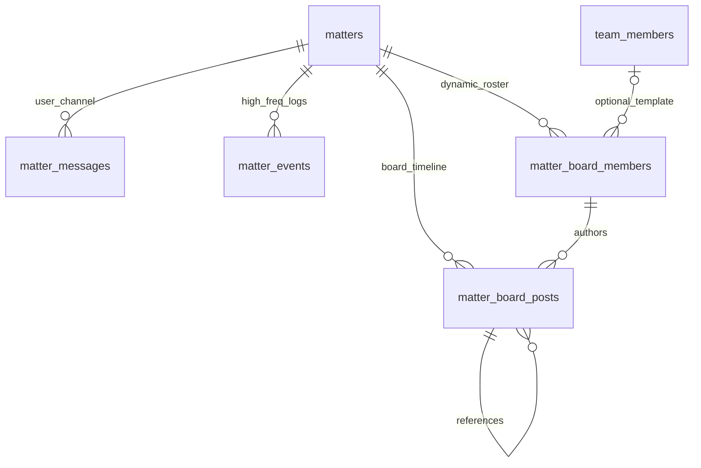
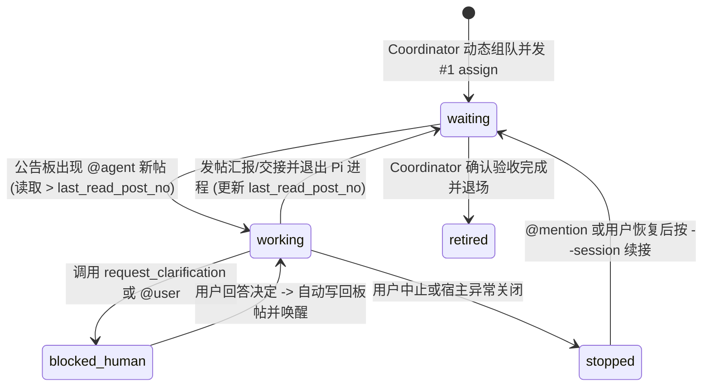

# 0.9.0 存储拆表与事项公告板协作设计草案

> **文档状态**：设计草案（面向 `0.9.0`，对应 [未来版本提案 P-0906](future-proposals.md#p-0906matter_messages-拆表与冷热分离优先级p1)）。尚未进入代码实现，不构成当前 `0.8.x` 已上线能力。

本设计将 **`P-0906`（`matter_messages` 拆表与冷热分离）** 与 **「人类发起方（用户）—交付总控（Coordinator）—能力中心（CoE）+ 共享公告板异步唤醒」** 统一收口到同一套 `0.9.0` 存储与编排底座中，同时结合 **信任四步 + RSI 沉淀闭环** 与 **Human-in-the-Loop（人在回路）三层可观测工作台** 进行系统化设计。

---

## 1. 设计目标与组织拓扑演进

### 1.1 解决当前 `0.8.x` 的两类结构性问题

1. **存储过载（`P-0906`）**：当前 [schema.ts](../../packages/server/src/storage/schema.ts) 中 `matter_messages` 同时承载 `user` 主对话、`internal_collab` 委托/大段回报正文、`notice` 高频工具日志，以及藏在 `metadata_json` 中的审批/澄清状态机，导致首屏读放大、缺少显式外键关系与生命周期清理边界。
2. **职能烟囱化与认知过载**：按固定工种预置业务角色（如 PM / EM / QA / Marketing）并强制主责兼任协调员（`## Matter lead coordination`），容易复刻传统软件组织中的**烟囱式架构**：
   - 业务主责既要承担深度专业产出，又要充当多方传话筒，上下文与注意力被碎片化（超出单会话的认知负荷上限）；
   - 固定角色各自守着职责领地与 `antiJobs` 边界，迫使任务迁就预设岗位，且协作者之间的返工必须经主责同步中转，拉长端到端交付路径。

### 1.2 组织拓扑演进：打破职能烟囱，转向「用户—交付总控—能力中心（CoE）」

基于康威定律与「逆康威定律」（先定义高内聚的端到端交付拓扑，再按任务组织团队），`0.9.0` 在保留轻量主责模式的同时，将复杂协作重构为三层职责：

```text
[用户（发起方/决策人）] ──(提目标/定约束/关键拍板/验收)──▶ [交付总控：Coordinator]
                                                                │
                              (从能力中心按任务切分垂直切片、装配 Skills 与信任授权)
                                                                ▼
                                       [事项公告板：按任务动态组建的扁平特性团队]
                                    Builder A ◀──(@交接/返工)──▶ Task Verifier
                                                                ▲
[能力中心 CoE：角色模板 + 专业/管理/验收 Skills + Role–Skill 关联 + 四步信任与 RSI]
```

1. **用户 = 人类发起方与决策人**（在不同场景中可以是内部管理岗、项目中的具体成员，或对外委托视角的需求方，系统不做单一身份假设）：只对目标、约束边界、关键分歧拍板和最终验收负责，无需手动替 AI 团队拆工单、盯排期或协调中间交接。
2. **Coordinator = 面向用户的交付总控**：
   - **对外沟通**：代表团队对接用户，澄清目标边界、同步阶段里程碑、在必要时发起 `@user` 拍板，并汇总最终经验证的交付成果。
   - **对内统筹与授权**：不被固化的 4 个职能部门框死，而是根据当前事项的自然结构，按**垂直切片**动态组建扁平团队、明确各成员的独占范围（`owned_scope`）与信任授权，随后退居 `waiting` 观察位，信任团队在公告板上自主推进，仅在异常或收口时介入（`Observe by default, Intervene by exception`）。
3. **能力中心（CoE）= 专业技能 + 角色关联 + 管理/验收经验**：
   - 原有 `roles/*.md` 与行业模板退位为**可复用的能力模板**，而非每个事项必须经过盖章的“固定职能部门”；
   - 能力中心同时沉淀**专业执行 Skills**、**Role–Skill 关联模板**、**Coordinator 组队与授权管理经验**以及 **Verifier 验收经验**，四者全部沿着四步信任与 RSI 闭环在真实运行证据中持续演化。

### 1.3 双模式共存与设计铁律

| 协作模式 | 适用场景 | 核心角色与通信方式 | 生命周期与成本 |
| --- | --- | --- | --- |
| **`lead`（轻量主责模式，保留）** | 咨询、单兵（`pi-default`）、轻量单轮委托 | 业务主责直接响应；`delegate_to_member` 同步工具返回 | 零调度税，向后兼容现有 `0.8.x` 全部事项 |
| **`board`（公告板模式，0.9.0 新增）** | 多切片并行交付、需要任务级定制团队与多轮返工闭环 | 专职 `Coordinator` + 动态切片 `Builder` + 定制 `Verifier` 共用公告板，通过 `@mention` 异步唤醒 | 成员跑完即退回 `waiting`（**零常驻 Token 成本**） |

坚持「顺着 Pi 纹理生长」原则：
- **利用 Pi 原语实现零成本挂起**：`pi --mode rpc --session` 跑完即退进程天然等于 `waiting`，无需维护常驻内存对话池；再次被 `@` 时按确切 `--session` 唤醒并仅喂入未读板帖，同时支持在 `waiting` 态原地切换模型并保留完整对话历史。

---

## 2. SQLite 存储拆表设计

### 2.1 四表协同结构总览

将原本臃肿的 `matter_messages` 按职责与冷热属性拆分为四张边界清晰的表（并在 `matters` 补充模式字段）；同时将 `matter_board_members` 从 `team_members` 强绑定中解耦，支持按任务动态组队：



### 2.2 逐表结构设计

#### (1) `matters`（扩展协作模式与专职调度员）

在现有 [matters](../reference/database-schema.md#matters) 基础上新增 2 列：

| 新增列 | SQLite 类型与约束 | 说明 |
| --- | --- | --- |
| `collaboration_mode` | `TEXT NOT NULL DEFAULT 'lead' CHECK (collaboration_mode IN ('lead', 'board'))` | 事项协作模式：`lead`（传统主责）\| `board`（公告板异步协同） |
| `coordinator_member_id` | `TEXT REFERENCES team_members(id)` | `board` 模式下的专职调度员 ID（可选，对接用户的交付总控角色） |

#### (2) `matter_messages`（瘦身为主对话与决策载体）

- **职责收敛**：仅保留用户与调度员/主责/旁听之间的正式对话（相当于原 `channel = 'user'`），不再写入 `notice` 工具事件与 `internal_collab` 内部委托正文。
- **结构化状态机增强**：新增显式索引/状态字段替代部分 `json_extract`：
  - `kind TEXT NOT NULL DEFAULT 'chat'`（`chat` \| `ai_request` \| `human_decision` \| `observer` \| `system_summary`）
  - `decision_status TEXT`（`pending` \| `approved` \| `dismissed` \| `answered` \| `NULL`，配合部分索引加速待决查询）
  - `board_post_no INTEGER`（可选，当调度员把某项板帖升级给用户拍板或引用最终板帖交付时建立精确锚点）

#### (3) `matter_events`（拆出高频 `notice` 过程日志）

独立承接高写入频率的工具执行摘要、能力握手清单与 `@monitor` 巡检记录，彻底消除主对话读放大。

| 字段名 | 类型与约束 | 说明 |
| --- | --- | --- |
| `id` | `TEXT PRIMARY KEY` | 事件 ID（`mevt_<uuid>`） |
| `matter_id` | `TEXT NOT NULL REFERENCES matters(id) ON DELETE CASCADE` | 所属事项 ID |
| `run_id` | `TEXT NOT NULL` | 所属执行轮次 ID |
| `agent_id` | `TEXT` | 触发该事件的执行体 ID（`lead` 模式为 `member_id`，`board` 模式为板内 `agent_id`） |
| `board_post_no` | `INTEGER` | `board` 模式下关联触发本轮执行的板帖号（`NULL` 表示 `lead` 模式） |
| `event_type` | `TEXT NOT NULL` | `tool_start` \| `tool_end` \| `capability_ready` \| `monitor_alert` \| `turn_summary` |
| `payload_json` | `TEXT NOT NULL` | 截断安全的紧凑 JSON 摘要（含脱敏/长度上限） |
| `created_at` | `TEXT NOT NULL` | ISO-8601 创建时间 |

- **索引**：`idx_matter_events_matter (matter_id, created_at DESC)`、`idx_matter_events_post (matter_id, board_post_no, created_at ASC)`。
- **读取策略**：事项首屏加载**默认不查 `matter_events`**；用户展开「过程事件」或点击某位成员进度条时按 `(matter_id, cursor, limit)` 分页拉取。

#### (4) `matter_board_posts`（统一承接 `internal_collab` 与共享公告板）

以严格单调递增的事项内帖号 `post_no`（`#1`, `#2`, ...）串联分工、汇报、返工与验收，支持**列表摘要 + 正文懒加载**。

| 字段名 | 类型与约束 | 说明 |
| --- | --- | --- |
| `id` | `TEXT PRIMARY KEY` | 板帖全局 ID（`bpost_<uuid>`） |
| `matter_id` | `TEXT NOT NULL REFERENCES matters(id) ON DELETE CASCADE` | 所属事项 ID |
| `post_no` | `INTEGER NOT NULL` | 事项内连续自增帖号（`#1`, `#2`, ...），同 `(matter_id, post_no)` 唯一 |
| `author_type` | `TEXT NOT NULL CHECK (author_type IN ('agent', 'user', 'monitor'))` | 发帖主体：`agent`（板内成员）\| `user`（人类用户）\| `monitor`（巡检） |
| `author_id` | `TEXT NOT NULL` | 板内 `agent_id`、用户 ID 或 `system_monitor` |
| `kind` | `TEXT NOT NULL CHECK (kind IN ('assign', 'progress', 'handoff', 'verify_pass', 'verify_rework', 'escalate', 'clarification', 'summary'))` | 帖子语义类型（分派 / 进展 / 交接 / 验收通过 / 验收打回 / 升级调度 / 请求用户决定 / 收尾总结） |
| `mentions_json` | `TEXT NOT NULL DEFAULT '[]'` | 定向唤醒目标列表（如 `["verifier"]`、`["coordinator"]`、`["@user"]`），禁止无约束 `@all` |
| `ref_post_nos_json` | `TEXT NOT NULL DEFAULT '[]'` | 引用的历史帖号数组（如 `[1, 4]`），避免重复粘贴前文消耗 Token |
| `summary` | `TEXT NOT NULL` | 单行紧凑摘要（≤ 240 字，看板底栏与增量提示直接展示） |
| `body` | `TEXT NOT NULL DEFAULT ''` | 完整正文（大段方案/代码差异/测试输出；列表接口可不返回，点开详情懒加载） |
| `artifacts_json` | `TEXT` | 产出物结构化清单（变更文件与行数、Git commit、`spaceDocumentId` 等） |
| `verification_json` | `TEXT` | 验收绑定信息（`target`、`criteria`、`verdict`: `pass`/`rework`/`pending`、`authorAgentId`） |
| `org_id` | `TEXT` | 写入时的有效组织快照 |
| `workspace_id` | `TEXT` | 写入时的工作区快照 |
| `created_at` | `TEXT NOT NULL` | ISO-8601 发帖时间 |

- **唯一与索引**：`UNIQUE (matter_id, post_no)`、`idx_board_posts_matter (matter_id, post_no DESC)`。

#### (5) `matter_board_members`（解绑固定岗位、支持按任务动态切片组队）

**关键解耦**：以 `(matter_id, agent_id)` 为主键，将 `source_member_id`（关联 `team_members(id)`）改为**可选模板引用**。Coordinator 既可直接引入能力中心的固定成员模板，也可按本次任务切片**动态生成临时执行者与定制 `verifier`**，任务完成后随板 `retired`，不污染全局常驻名册。

| 字段名 | 类型与约束 | 说明 |
| --- | --- | --- |
| `matter_id` | `TEXT NOT NULL REFERENCES matters(id) ON DELETE CASCADE` | 事项 ID |
| `agent_id` | `TEXT NOT NULL` | 事项内唯一成员标识（如 `coordinator`、`storage-slice`、`web-slice`、`verifier`） |
| `source_member_id` | `TEXT REFERENCES team_members(id) ON DELETE SET NULL` | 可选来源角色模板（`NULL` 表示由 Coordinator 按本次任务动态定制，非固定岗位） |
| `display_name` | `TEXT NOT NULL` | 看板展示名称（如 `Storage Slice Builder`、`Task Verifier`） |
| `board_role` | `TEXT NOT NULL CHECK (board_role IN ('coordinator', 'builder', 'verifier'))` | 板内职能：`coordinator`（总控不写代码）\| `builder`（垂直切片交付）\| `verifier`（只读/只测验收） |
| `brief` | `TEXT NOT NULL DEFAULT ''` | 任务简报（范围、目标与约束；动态成员启动时注入系统上下文） |
| `skills_json` | `TEXT NOT NULL DEFAULT '[]'` | 从能力中心（CoE）为该成员按需装配的 Skill 名称列表 |
| `status` | `TEXT NOT NULL DEFAULT 'waiting' CHECK (status IN ('working', 'waiting', 'blocked_human', 'stopped', 'retired'))` | 成员状态：`working` / `waiting`（零成本休眠）/ `blocked_human`（等用户决定）/ `stopped` / `retired`（退场留痕） |
| `owned_scope_json` | `TEXT NOT NULL DEFAULT '[]'` | 独占文件/目录芯片（如 `["src/terrain_math.js", "src/world.js"]`）与验收命令（`["node --test"]`） |
| `acceptance_criteria` | `TEXT NOT NULL DEFAULT ''` | 由 Coordinator 为当前任务定制的验收标准（重点注入给 `verifier`） |
| `last_read_post_no` | `INTEGER NOT NULL DEFAULT 0` | 已消费的最大板帖号，用于增量补读与抗 Pi Compaction 断层恢复 |
| `active_post_no` | `INTEGER` | 当前正在处理的触发帖号 |
| `model_override_json` | `TEXT` | 事项板内单成员临时/原地切换的模型配置（仅 `waiting` 时可热切换，保留原 Pi 会话） |
| `worktree_path` | `TEXT` | 预留字段：后续支持 `share` 独立工作副本时的路径指针（`0.9.0` 初期为 `NULL`） |
| `metrics_json` | `TEXT` | 看板实时收敛指标（`linesAdded`, `linesDeleted`, `testsPassed`, `testsTotal`, `lastAction`, `progressPct`） |
| `updated_at` | `TEXT NOT NULL` | ISO-8601 状态更新时间 |

- **主键**：`PRIMARY KEY (matter_id, agent_id)`。

---

## 3. 编排引擎与异步唤醒闭环

### 3.1 核心调度与状态流转



### 3.2 四项核心编排规则

1. **板内原语工具（`pa-extensions/board`）**：
   - `spawn_board_agent({ agentId, displayName, boardRole, sourceMemberId?, brief, skills?, ownedScope, acceptanceCriteria?, modelSelection? })`：**仅 `Coordinator` 可调用**，按当前任务动态创建垂直切片成员或引入 CoE 模板，声明其独占文件边界、装配的 CoE Skills 与任务验收标准。
   - `post_to_board({ kind, mentions, refPostNos?, summary, body, artifacts?, verification? })`：写入 `matter_board_posts` 获取连续 `#N` 帖号；**硬校验**禁止 `@all` 群发（仅 `coordinator` 初次 `assign` 可一次 `@` 多个起始成员），且 `verifier` 不得与被验收产出作者为同一 `agent_id`。
   - `read_board_post({ postNos })`：当板帖长正文被宿主折叠或经 Pi Compaction 后，成员按帖号按需读取完整 `body`。
2. **基于游标的增量唤醒（零冗余 Token）**：
   - 宿主监听器检测到新帖的 `mentions` 包含目标 `agent_id` 后，将其状态置为 `working`（若当前仍在 `working`，新帖直接排队，等当前轮退出后再消费）。
   - 拉起 `pi --mode rpc --session` 时，宿主**仅注入 `(last_read_post_no, latest_post_no]` 区间内的板帖摘要**（包含 `ref_post_nos` 提示）；长正文默认只给 `summary` + 帖号，需要细节再调 `read_board_post`。跑完一轮立刻释放 Pi 进程并推进 `last_read_post_no`，成员回到 `waiting` 零成本态。
3. **管理者原则：`Observe by default, Intervene by exception`**：
   - **平时休眠、信任授权**：只要 `builder` 与 `verifier` 在板上通过 `@verifier` / `@<builder>` 闭环返工，且 `mentions` 不含 `coordinator`，**`Coordinator` 始终保持 `waiting`**，既不截留沟通带宽，也不消耗任何模型 Token。
   - **三种异常/边界唤醒**：
     1. 成员显式 `@coordinator`（验收全通过请求收尾、需求冲突、连续返工超限需要裁决）；
     2. **`@monitor`（升级版 [turn-monitor.ts](../../packages/server/src/orchestrator/execution/turn-monitor.ts)）**：除保留单 Worker 180 秒无活动心跳提醒外，新增板级扫描——当 `matter` 处于 `board` 模式且未闭环、所有成员均为 `waiting` 且无待决用户提问超过阈值（如 30 秒无新 `@mention` 派发）时，自动写入一条 `author_type = 'monitor'` 的板帖点名 `@coordinator`（或唯一卡点成员）解卡；
     3. **用户随时插话**：用户向主对话发消息时，唤醒休眠的 `Coordinator`（读取增量板帖后立即掌握全局并调整指令）。
4. **定制 Verifier 与并发写安全边界**：
   - **CoE 底座 + 任务级定制**：`verifier` 可选复用 `qa-manager` 等 CoE 模板或由 `Coordinator` 现场定制，重点在于由 `Coordinator` 注入本次任务专属的 `acceptance_criteria` 与 `owned_scope`（验证命令、核查清单），且宿主对其工具集按只读/测试边界约束，禁止其直接修改业务源码。
   - **0.9.0 务实并发边界**：由于多数本地业务仓库仍为单目录，0.9.0 第一阶段采用**「所有权声明（`owned_scope_json` 不重叠）+ 同仓库写操作串行队列 / 只读 Verifier 与多仓库可并行」**，确保不踩坏同一本地工作区；并在 `matter_board_members.worktree_path` 预留字段，供后续按需演进 `git worktree` 真并行写入。

### 3.3 能力中心（CoE）× 信任四步 × RSI 统一沉淀闭环

`board` 模式的复盘与沉淀**不另建私有记忆表**，继续顺着 Pi 原生 `SKILL.md`、`roles/*.md`、`skill_trust_policies` 与 `session-insights` 纹理运行，将运行经验统一沉淀为四类可复用资产：

| 沉淀资产类型 | 沉淀入口与载体 | 信任门禁与治理（Four-Step Trust） | 证据来源与复用方式 |
| --- | --- | --- | --- |
| **1. 专业执行技能（Skills & Scripts）** | `builder` 通过 `propose_skill` 沉淀标准 `SKILL.md` + `scripts/*`（按 `global`/`org`/`personal`/`workspace` 落盘） | 经用户审核落盘默认 `autonomous`，未审脚本默认 `confirm` 经 `DialogBroker` 确认，`disabled` 阻断 | 挂载于对应作用域 `--skill`，供后续事项直接发现与执行 |
| **2. 角色模板与 Role–Skill 关联** | 某类动态切片成员在多个 `board` 事项中反复出现且运行稳定时，通过 `propose_role` 沉淀为 CoE 角色模板并固化 `skills` 关联清单 | 需经有权限用户确认卡落盘（`.data/roles/`），按 `roleScope` 隔离 | 后续 `Coordinator` 可通过 `sourceMemberId` 一键引入并继承整套绑定 Skills |
| **3. Coordinator 管理与协作经验** | 将有效的切片划分策略、并发冲突规避、返工收敛阈值与授权规则通过 `propose_skill` 沉淀为**编排管理类 Skill** | 管理类涉及高风险批处理脚本时同样受 `skill_trust_policies` 约束 | 自动挂入 Coordinator 的能力清单，直接提升后续任务的动态组队与授权水平 |
| **4. Verifier 验收经验与检查脚本** | 将可复用的边界反例清单、迁移校验脚本、静态/端到端验收脚本沉淀为**验收类 Skill + `scripts/*`** | 验收脚本执行同样走 `tool_call` Hook 与 `skill_trust_policies`（`confirm` → `autonomous`） | Coordinator 在 `spawn_board_agent` 定制 `verifier` 时按任务类型按需装配 |

**确定性 RSI 证据闭环**：
- `matter_board_posts` 中的 `verify_rework` 返工频次、`escalate` 升级原因与 `matter_events` 中的 `monitor_alert` 停滞告警，配合 Pi JSONL 会话日志，作为零模型成本 `session-insights` 与 `team-health.ts` 的结构化体检证据；
- 在「团队协作体检」中可据此直接识别高频返工模式或缺失的 Role–Skill 关联，并生成 `propose_skill` / `propose_role` 改进建议。

---

## 4. Human-in-the-Loop 与用户可观测性设计

### 4.1 用户如何观察协作过程（三层渐进式视图）

借鉴高信息密度并行看板的收敛体验，同时保留 PA 对话工作台的清爽主视线：

| 信息层级 | 展示位置 | 用户看到什么 | 设计目的 |
| --- | --- | --- | --- |
| **L1：主对话与顶栏态势条** | 左侧/主聊天流 + 顶栏 | 仅渲染 `matter_messages`（用户输入、Coordinator 对外沟通与汇报、待决策卡片）+ 顶栏紧凑状态胶囊（如 `Board · 3 working / 1 waiting`） | 主对话干净不刷屏，一眼知道整体在跑还是卡住 |
| **L2：并行看板（Board Drawer / Split Pane）** | 右侧或顶部可展开看板视图 | 1. **成员卡片网格**：每人一张卡，顶部显示 `board_role` 徽章、`display_name` 与 `owned_scope` 文件芯片（如 `src/player.js`），右侧显示状态灯（`Working` / `Waiting 休眠` / `Blocked` / `Done`），底部显示收敛指标（`+231 lines` / `3/3 unit tests PASS`）<br>2. **底部紧凑 `SHARED BOARD` 交接条**：固定展示最新 2–3 条带帖号的交接摘要（如 `#2 physics @verifier · 提交 player.js (+231)`） | 不用点开长日志，1 秒看清「团队拆了哪些切片、谁负责哪几个文件、进展到哪、谁卡住了」 |
| **L3：板帖正文与过程事件详情** | 点击某帖号 `#N` 或成员卡片 | 按需异步请求 `GET /api/matters/:id/board/posts/:postNo` 或 `GET /api/matters/:id/events` 分页查看完整评审正文、diff 与工具命令行轨迹 | 把冷数据与大文本留在按需请求，兼顾深度排障与首屏性能 |

### 4.2 Human-in-the-Loop 四种介入方式

1. **显式阻塞拍板（`@user` / `request_clarification`）**：
   - 任何成员或 `Coordinator` 需要人类决策时，发 `kind = 'clarification'` 且 `@user` 的板帖，该成员进入 `blocked_human`；
   - 宿主同步在 `matter_messages` 生成 `kind = 'human_decision'`（复用现有 [human-decision.ts](../../packages/contracts/src/human-decision.ts) 与前端 `FloatingClarificationDock`），用户选好选项或输入答复后，**写回为一条 `author_type = 'user'` 的板帖并自动唤醒原请求成员**。
2. **随时插话纠偏（唤醒休眠 Coordinator）**：
   - 因为专职 `Coordinator` 不亲自埋头写代码，用户任何时候在主输入框发消息，都直接唤醒 `Coordinator` 消费增量板帖并下达新指令（如“先停掉测试，改用方案 B”），无需等待底层所有 `builder` 跑完。
3. **成员级精细控制（看板卡片直接操作）**：
   - **暂停/恢复单成员**：在卡片上把某成员置为 `stopped` 或重新唤醒；
   - **原地热切换模型**：当某成员遇到模型额度不足或需提升推理深度时，在成员处于 `waiting` 时直接切换 `model_override_json`，下一轮唤醒继续沿用原 `--session` 历史；
   - **直达某成员发帖**：支持用户在看板底部直接发送带 `@<agentId>` 的板帖，定向唤醒特定成员而无需经过全体重跑。
4. **高风险操作与脚本信任门禁**：
   - 所有成员在执行沉淀脚本或敏感工具时，依然统一经过 Pi 原生 `tool_call` Hook 与 `skill_trust_policies` + `DialogBroker` 弹窗确认（信任四步），不因进入 `board` 模式或动态组队而绕过安全门禁。

### 4.3 SSE 增量推送契约扩展

在 [sse-events.ts](../../packages/contracts/src/sse-events.ts) 中新增 3 个轻量事件，避免每产生一条板帖或状态变化就整量重刷 `GET /api/matters/:id`：

- `board_post_created`: `{ matterId, postNo, kind, authorId, mentions, summary, createdAt }`（仅推摘要与元信息，不推大 `body`）
- `board_member_updated`: `{ matterId, agentId, status, activePostNo, metrics, updatedAt }`
- `matter_event_appended`: `{ matterId, runId, agentId, eventType, createdAt }`（仅提示过程面板增量刷新）

---

## 5. `0.8.x → 0.9.0` 兼容性与迁移策略

1. **库格式升级与无损迁移**：
   - 将 `database.ts` 中的数据库标识从 `0x50413730`（`PA70`）升级为 `0.9.0` 标识（或配合 `PRAGMA user_version` 版本号递进），打开存量 `0.8.x` 数据库时在 `BEGIN IMMEDIATE` 事务内执行幂等迁移：
     - 建新表 `matter_events`、`matter_board_posts`、`matter_board_members`；
     - 为 `matters`、`matter_messages` 补充新列；
     - 将历史 `matter_messages` 中 `channel = 'notice'` 迁移至 `matter_events`，`channel = 'internal_collab'` 迁移为 `matter_board_posts`（按事项时间顺序生成连续 `post_no`，保留原消息 ID 引用）；
     - 清理或归档 `matter_messages` 已迁出的非 `user` 行。
2. **契约与 API 渐进切换**：
   - 保留 `GET /api/matters/:id` 返回核心事项与 `user` 对话消息；
   - 新增 `GET /api/matters/:id/board`（动态成员状态 + 板帖摘要列表）、`GET /api/matters/:id/board/posts/:postNo`（单帖完整正文懒加载）、`POST /api/matters/:id/board/posts`（用户发帖/纠偏）与 `GET /api/matters/:id/events`（过程事件分页）。
3. **文档与变更记录同步**：
   - 实施时同步更新 [SQLite 库表设计参考](../reference/database-schema.md#6-维护流程与变更记录)、[运行与协作参考](../reference/runtime-collaboration.md) 与 [架构说明](architecture-and-plan.md)。

---

## 6. 分阶段落地里程碑

| 里程碑 | 范围与核心交付 | 验收标准 |
| --- | --- | --- |
| **M1：存储拆表与只读懒加载（`P-0906` 核心）** | 完成 `matter_events` / `matter_board_posts` / `matter_board_members` 建表与 `0.8.x` 迁移；现有 `lead` 模式的 `notice` 与 `internal_collab` 改写新表，前端协作浮层与过程面板切到分页/懒加载 API | 存量 `0.8.x` 库无损升级；首屏 `GET /api/matters/:id` 不再返回海量 `notice` 与长篇内部回报正文；现有 `npm test` 与 `demo:team` 全通过 |
| **M2：Board 动态组队闭环与 `@monitor`** | 上线 `collaboration_mode = 'board'`、专职 `Coordinator`、`spawn_board_agent`/`post_to_board`/`read_board_post`、`last_read_post_no` 增量唤醒、`@monitor` 停滞检测与 `waiting` 原地换模型 | 实现「用户下达目标 → Coordinator 动态切片组队并发 `#1` → Builder ↔ Verifier 至少 1 轮返工闭环 → Coordinator 汇总交付」全自动运转，且过程中 Coordinator 在无异常时保持零唤醒 |
| **M3：看板 UI、HITL 与 CoE 沉淀闭环** | 上线前端 3 层可观测看板（文件芯片、进度/行数/测试指标、2 行 `SHARED BOARD` 交接条、单帖正文弹窗）、单成员暂停/换模型、直接 `@<agentId>` 发帖、`@user` 澄清联动，以及把 `board` 返工/告警指标接入 `session-insights` / `team-health` 驱动四类资产沉淀 | 可在 `start:team:sandbox` 与真实 Pi 场景下完整观测、中途介入纠偏，并完成 Skill / Role–Skill / Coordinator / Verifier 经验沉淀闭环（新增 `demo:board` 验证） |
