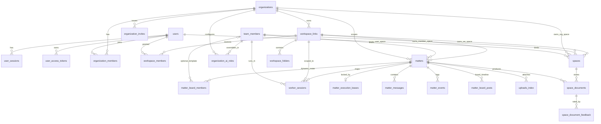

# SQLite 库表设计参考

本文档以 [schema.ts](../../packages/server/src/storage/schema.ts)、[database.ts](../../packages/server/src/storage/database.ts)、[types.ts](../../packages/server/src/storage/types.ts) 与各域仓储实现（`packages/server/src/storage/repos/*.ts`）为唯一真相源，描述 Personal Agent 当前（`0.9.0-m1` 存储拆表基线）SQLite 数据库的 26 张表结构、索引、约束及事务一致性约定。

## 1. 引擎配置与存储边界

### 1.1 打开与初始化约定

由 [openPersonalAgentDatabase](../../packages/server/src/storage/database.ts) 统一打开与初始化：

- **驱动与模式**：使用 Node.js 内置 `node:sqlite`（`DatabaseSync`），打开即执行 `PRAGMA foreign_keys = ON`；非 `:memory:` 文件数据库在事务提交后启用 `PRAGMA journal_mode = WAL`。
- **格式标识与无损迁移**：沿用 `PRAGMA application_id = 0x50413730`（ASCII `PA70`），并推进 `PRAGMA user_version = 900`（`0.9.0` 基线）。
  - 打开**空库**（`application_id = 0`、`user_version = 0` 且无用户表）时，在 `BEGIN IMMEDIATE` 事务内一次性执行 `SCHEMA_SQL` 建全表并写入 `application_id` 与 `user_version = 900`。
  - 打开**已有库**且 `application_id === 0x50413730` 时，在 `BEGIN IMMEDIATE` 事务内幂等执行升级：
    - 通过 `CREATE TABLE IF NOT EXISTS` 补建 `user_access_tokens`、`skill_trust_policies`、`matter_events`、`matter_board_posts`、`matter_board_members`（含索引）；
    - 检查 `PRAGMA table_info(...)` 为 `matters` 补建 `collaboration_mode`、`coordinator_member_id`，为 `matter_messages` 补建 `kind`、`decision_status`、`board_post_no` 与部分索引 `idx_matter_messages_decision_status`；
    - 幂等无损回填历史 `matter_messages`：将 `channel = 'notice'` 映射回填至 `matter_events`（主键 `mevt_<msgId>`），将 `channel = 'internal_collab'` 按事项创建时间顺序生成连续 `post_no` 回填至 `matter_board_posts`（主键 `bpost_<msgId>`）并同步写入 `matter_messages.board_post_no`，同时保留原 `matter_messages` 行以保证 `lead` 模式向后兼容。
  - 打开其他非 `0x50413730` 非空数据库时直接抛错拒绝，不迁移也不覆盖旧数据。

### 1.2 不落入 SQLite 的数据边界

按「顺着 Pi 纹理生长」原则，SQLite 仅存关系索引、领域元数据与轻量指针，以下内容分别由各自存储层承担：

| 数据类别 | 实际载体 | 说明 |
| --- | --- | --- |
| AI 模型完整对话历史 | Pi `--session` JSONL 文件 | `worker_sessions` 仅存映射与文件指针 |
| 资料空间文档正文与版本历史 | `<dataDir>/spaces/{orgs,workspaces,users,members,custom}/<id>/` 独立 Git 仓 | `spaces` / `space_documents` 仅存空间/文件索引与 `head_commit` |
| 沉淀的可复用 Skills 与脚本 | `.data/skills/` 或 `<workspace>/.agents/skills/` 磁盘文件 | SQLite 仅在 `skill_trust_policies` 保存信任等级与执行统计 |
| 待答人机交互与预览进程 | `DialogBroker` / `PreviewManager` 进程内存 | 不随宿主重启持久化 |
| 历史旧版 `member_memories` | 已下线移除 | 由磁盘标准 `SKILL.md` 沉淀与 `space_document_feedback` 替代 |

---

## 2. 实体关系总览

---

## 3. 分域逐表设计（共 26 张表）

### 3.1 账号、鉴权与平台配置（5 张）

#### `users`
- **仓储**：[user-auth-repo.ts](../../packages/server/src/storage/repos/user-auth-repo.ts)
- **主键 / 唯一约束**：`PRIMARY KEY (id)`；`UNIQUE (email COLLATE NOCASE)`
- **说明**：平台人类用户账号、密码哈希与配额限制。本机免密回环模式默认创建 `usr_local_owner`（`password_hash = ''`）。

| 字段名 | 类型与约束 | 说明 |
| --- | --- | --- |
| `id` | `TEXT PRIMARY KEY` | 用户 ID（如 `usr_<uuid12>` 或 `usr_local_owner`） |
| `email` | `TEXT NOT NULL UNIQUE COLLATE NOCASE` | 登录邮箱，大小写不敏感唯一 |
| `display_name` | `TEXT NOT NULL` | 用户显示名 |
| `password_hash` | `TEXT NOT NULL DEFAULT ''` | `scrypt$<salt>$<hex>` 格式口令哈希；空字符串表示免密占位账号 |
| `platform_role` | `TEXT NOT NULL DEFAULT 'user'` | 平台角色：`super_admin` \| `user` |
| `status` | `TEXT NOT NULL DEFAULT 'active'` | 账号状态：`active` \| `pending_review` \| `disabled` |
| `max_orgs` | `INTEGER NOT NULL DEFAULT 5` | 允许拥有的组织数量上限 |
| `max_active_dispatches` | `INTEGER NOT NULL DEFAULT 3` | 并发 AI 派发上限 |
| `max_personal_roles` | `INTEGER NOT NULL DEFAULT 5` | 个人私有 AI 角色配额 |
| `can_dispatch_ai` | `INTEGER NOT NULL DEFAULT 1` | 布尔标记（`0`/`1`），是否允许触发 AI 派发 |
| `created_at` | `TEXT NOT NULL` | ISO-8601 创建时间 |
| `updated_at` | `TEXT NOT NULL` | ISO-8601 更新时间 |

#### `user_sessions`
- **仓储**：[user-auth-repo.ts](../../packages/server/src/storage/repos/user-auth-repo.ts)
- **主键 / 外键**：`PRIMARY KEY (id)`；`user_id REFERENCES users(id) ON DELETE CASCADE`
- **说明**：Web 登录会话记录，默认有效期 30 天。

| 字段名 | 类型与约束 | 说明 |
| --- | --- | --- |
| `id` | `TEXT PRIMARY KEY` | 原始 `pas_*` 会话令牌的 SHA-256 十六进制摘要 |
| `user_id` | `TEXT NOT NULL` | 所属用户 ID |
| `expires_at` | `TEXT NOT NULL` | ISO-8601 过期时间 |
| `revoked_at` | `TEXT` | 撤销时间戳，`NULL` 表示未撤销 |
| `ip` | `TEXT NOT NULL DEFAULT ''` | 登录来源 IP |
| `user_agent` | `TEXT NOT NULL DEFAULT ''` | 客户端 User-Agent（截断至 240 字符） |
| `created_at` | `TEXT NOT NULL` | ISO-8601 创建时间 |

#### `user_access_tokens`
- **仓储**：[user-auth-repo.ts](../../packages/server/src/storage/repos/user-auth-repo.ts)
- **主键 / 唯一约束 / 外键**：`PRIMARY KEY (id)`；`UNIQUE (token_hash)`；`user_id REFERENCES users(id) ON DELETE CASCADE`
- **说明**：个人访问令牌（PAT，前缀 `pat_*`），支持按组织/工作区裁剪权限作用域。

| 字段名 | 类型与约束 | 说明 |
| --- | --- | --- |
| `id` | `TEXT PRIMARY KEY` | 令牌 ID（`tok_<uuid>`） |
| `user_id` | `TEXT NOT NULL` | 所属用户 ID |
| `name` | `TEXT NOT NULL` | 用户自定义令牌名称（≤80 字符） |
| `token_hash` | `TEXT NOT NULL UNIQUE` | 原始令牌的 SHA-256 十六进制摘要 |
| `token_prefix` | `TEXT NOT NULL` | 原始令牌前 12 位明文前缀（用于界面展示识别） |
| `scope` | `TEXT NOT NULL DEFAULT 'read' CHECK (scope IN ('read', 'full'))` | 令牌权限档位：`read` \| `full` |
| `allowed_org_ids_json` | `TEXT` | 允许访问的组织 ID JSON 数组；`NULL` 表示不限 |
| `allowed_workspace_ids_json` | `TEXT` | 允许访问的工作区 ID JSON 数组；`NULL` 表示不限 |
| `expires_at` | `TEXT` | 过期时间（`NULL` 表示永不过期） |
| `last_used_at` | `TEXT` | 最近一次鉴权使用时间 |
| `revoked_at` | `TEXT` | 撤销时间（`NULL` 表示有效） |
| `created_at` | `TEXT NOT NULL` | ISO-8601 创建时间 |

#### `platform_settings`
- **仓储**：[user-auth-repo.ts](../../packages/server/src/storage/repos/user-auth-repo.ts)
- **主键**：`PRIMARY KEY (key)`
- **说明**：平台级键值配置表，当前固定使用 `key = 'platform_settings'` 存储全站安全与默认配额 JSON。

| 字段名 | 类型与约束 | 说明 |
| --- | --- | --- |
| `key` | `TEXT PRIMARY KEY` | 配置键，当前固定为 `'platform_settings'` |
| `value_json` | `TEXT NOT NULL` | `PlatformSettings` JSON：`registrationMode`（`open_auto`\|`open_review`\|`invite_only`）、`workspacesRoot`、`allowLocalWorkspacePath`、`localWorkspaceAllowlist`、`allowCommandPreviews`、`systemOneEnabled`、`defaultMaxOrgs`、`defaultMaxActiveDispatches`、`defaultMaxPersonalRoles`、`webAccessDeniedRoles`、`webSearchProvider`（`auto`\|`deepseek`\|`exa`\|`kimi`）、`defaultModelSelection` |
| `updated_at` | `TEXT NOT NULL` | ISO-8601 更新时间 |

#### `audit_logs`
- **仓储**：[user-auth-repo.ts](../../packages/server/src/storage/repos/user-auth-repo.ts)
- **主键**：`PRIMARY KEY (id)`
- **说明**：管理与敏感操作审计轨迹。

| 字段名 | 类型与约束 | 说明 |
| --- | --- | --- |
| `id` | `TEXT PRIMARY KEY` | 审计 ID（`aud_<uuid12>`） |
| `actor_user_id` | `TEXT` | 操作人用户 ID（系统操作可为 `NULL`） |
| `actor_email` | `TEXT NOT NULL DEFAULT ''` | 操作人邮箱快照 |
| `actor_name` | `TEXT NOT NULL DEFAULT ''` | 操作人名称快照 |
| `action` | `TEXT NOT NULL` | 动作标识 |
| `target_type` | `TEXT NOT NULL DEFAULT ''` | 目标资源类型 |
| `target_id` | `TEXT NOT NULL DEFAULT ''` | 目标资源 ID |
| `org_id` | `TEXT` | 关联组织 ID（可选） |
| `detail_json` | `TEXT` | 动作附加详情 JSON（可选） |
| `ip` | `TEXT NOT NULL DEFAULT ''` | 来源 IP |
| `created_at` | `TEXT NOT NULL` | ISO-8601 记录时间 |

---

### 3.2 组织与多租户 RBAC（4 张）

#### `organizations`
- **仓储**：[organization-repo.ts](../../packages/server/src/storage/repos/organization-repo.ts)
- **主键**：`PRIMARY KEY (id)`
- **说明**：组织实体，维护默认组织标记（`org-default`）与 Git 署名策略。

| 字段名 | 类型与约束 | 说明 |
| --- | --- | --- |
| `id` | `TEXT PRIMARY KEY` | 组织 ID（默认组织为 `org-default`，新建为 `org_<uuid>`） |
| `name` | `TEXT NOT NULL` | 组织名称 |
| `slug` | `TEXT NOT NULL DEFAULT ''` | URL/目录友好的组织短标识 |
| `git_email_domain` | `TEXT NOT NULL DEFAULT ''` | 组织默认 Git 邮箱域名（用于派生角色邮箱） |
| `use_role_git_identity` | `INTEGER NOT NULL DEFAULT 0` | 布尔标记（`0`/`1`）；为 `0` 时使用目标仓库自身 Git 配置，为 `1` 时注入角色 `GIT_AUTHOR_*` |
| `description` | `TEXT NOT NULL DEFAULT ''` | 组织简介 |
| `is_default` | `INTEGER NOT NULL DEFAULT 0` | 布尔标记（`0`/`1`），是否全局默认组织 |
| `workspaces_dir` | `TEXT` | 组织专属克隆工作区根目录（可选） |
| `created_by_user_id` | `TEXT` | 创建人用户 ID（可选） |
| `created_at` | `TEXT NOT NULL` | ISO-8601 创建时间 |
| `updated_at` | `TEXT NOT NULL` | ISO-8601 更新时间 |

#### `organization_members`
- **仓储**：[org-rbac-repo.ts](../../packages/server/src/storage/repos/org-rbac-repo.ts)
- **主键 / 外键**：`PRIMARY KEY (org_id, user_id)`；`org_id REFERENCES organizations(id) ON DELETE CASCADE`；`user_id REFERENCES users(id) ON DELETE CASCADE`
- **说明**：人类用户与组织的隶属及 RBAC 角色关系（强校验至少保留一名 `org_owner`）。

| 字段名 | 类型与约束 | 说明 |
| --- | --- | --- |
| `org_id` | `TEXT NOT NULL` | 组织 ID |
| `user_id` | `TEXT NOT NULL` | 用户 ID |
| `org_role` | `TEXT NOT NULL DEFAULT 'org_member'` | 组织角色：`org_owner` \| `org_admin` \| `org_member` \| `org_viewer` |
| `role_title` | `TEXT NOT NULL DEFAULT ''` | 人类成员在组织内的岗位头衔 |
| `created_at` | `TEXT NOT NULL` | ISO-8601 加入时间 |
| `updated_at` | `TEXT NOT NULL` | ISO-8601 更新时间 |

#### `organization_invites`
- **仓储**：[org-rbac-repo.ts](../../packages/server/src/storage/repos/org-rbac-repo.ts)
- **主键 / 唯一约束 / 外键**：`PRIMARY KEY (id)`；`UNIQUE (token_hash)`；`org_id REFERENCES organizations(id) ON DELETE CASCADE`
- **说明**：组织邀请码（前缀 `orginv_*`），采用哈希存储与事务内核销计数。

| 字段名 | 类型与约束 | 说明 |
| --- | --- | --- |
| `id` | `TEXT PRIMARY KEY` | 邀请记录 ID（`oinv_<uuid12>`） |
| `org_id` | `TEXT NOT NULL` | 目标组织 ID |
| `token_hash` | `TEXT NOT NULL UNIQUE` | 邀请令牌 SHA-256 哈希 |
| `org_role` | `TEXT NOT NULL DEFAULT 'org_member'` | 受邀加入后授予的组织角色 |
| `created_by_user_id` | `TEXT NOT NULL` | 创建邀请的用户 ID |
| `max_uses` | `INTEGER NOT NULL DEFAULT 1` | 最大可用次数（代码中限制 1–500，默认 20） |
| `used_count` | `INTEGER NOT NULL DEFAULT 0` | 已核销次数 |
| `expires_at` | `TEXT` | 过期时间（默认 7 天） |
| `revoked_at` | `TEXT` | 撤销时间（`NULL` 表示未撤销） |
| `created_at` | `TEXT NOT NULL` | ISO-8601 创建时间 |

#### `organization_ai_roles`
- **仓储**：[org-rbac-repo.ts](../../packages/server/src/storage/repos/org-rbac-repo.ts)
- **主键 / 外键**：`PRIMARY KEY (org_id, member_id)`；`org_id REFERENCES organizations(id) ON DELETE CASCADE`；`member_id REFERENCES team_members(id) ON DELETE CASCADE`
- **说明**：组织维度的 AI 岗位启停、主联系人设定，以及显示名/模型/思考档位/Git 署名覆盖（不适用于 `personal` 角色）。

| 字段名 | 类型与约束 | 说明 |
| --- | --- | --- |
| `org_id` | `TEXT NOT NULL` | 组织 ID |
| `member_id` | `TEXT NOT NULL` | AI 成员 ID |
| `enabled` | `INTEGER NOT NULL DEFAULT 1` | 布尔标记（`0`/`1`），在该组织是否启用 |
| `is_primary_contact` | `INTEGER NOT NULL DEFAULT 0` | 布尔标记（`0`/`1`），是否该组织的默认主联系人 |
| `display_name_override` | `TEXT` | 组织内显示名覆盖 |
| `provider_override` | `TEXT` | 模型供应商覆盖 |
| `model_override` | `TEXT` | 模型 ID 覆盖 |
| `thinking_level_override` | `TEXT` | 默认 thinking 档位覆盖 |
| `git_name_override` | `TEXT` | 组织内 Git Author Name 覆盖 |
| `git_email_override` | `TEXT` | 组织内 Git Author Email 覆盖 |
| `created_at` | `TEXT NOT NULL` | ISO-8601 创建时间 |
| `updated_at` | `TEXT NOT NULL` | ISO-8601 更新时间 |

---

### 3.3 AI 角色与技能信任（3 张）

#### `team_members`
- **仓储**：[member-repo.ts](../../packages/server/src/storage/repos/member-repo.ts)
- **主键**：`PRIMARY KEY (id)`
- **说明**：AI 岗位运行态成员记录，对应磁盘角色 Markdown 模板，承载作用域隔离及私有 Git 署名信息。

| 字段名 | 类型与约束 | 说明 |
| --- | --- | --- |
| `id` | `TEXT PRIMARY KEY` | AI 成员稳定 ID（如 `product-manager`、`pi-default`、`role-architect`） |
| `template_id` | `TEXT NOT NULL` | 关联的角色模板 ID |
| `display_name` | `TEXT NOT NULL` | 显示名 |
| `role_title` | `TEXT NOT NULL` | 岗位头衔 |
| `is_primary_contact` | `INTEGER NOT NULL DEFAULT 0` | 布尔标记（`0`/`1`），仅 `role_scope = 'global'` 允许设为全局主联系人 |
| `keywords_json` | `TEXT NOT NULL DEFAULT '[]'` | 路由关键词 JSON 字符串数组 |
| `git_name` | `TEXT NOT NULL DEFAULT ''` | 私有 Git Author Name |
| `git_email` | `TEXT NOT NULL DEFAULT ''` | 私有 Git Author Email（默认 `<id>@team.local`） |
| `identity_summary` | `TEXT NOT NULL DEFAULT ''` | 成员私有身份补充摘要 |
| `role_scope` | `TEXT NOT NULL DEFAULT 'global'` | 角色作用域：`global` \| `org` \| `personal` |
| `owner_org_id` | `TEXT` | 当 `role_scope = 'org'` 时的归属组织 ID |
| `owner_user_id` | `TEXT` | 当 `role_scope = 'personal'` 时的归属用户 ID |
| `created_at` | `TEXT NOT NULL` | ISO-8601 创建时间 |
| `updated_at` | `TEXT NOT NULL` | ISO-8601 更新时间 |

#### `removed_role_templates`
- **仓储**：[member-repo.ts](../../packages/server/src/storage/repos/member-repo.ts)
- **主键**：`PRIMARY KEY (template_id)`
- **说明**：记录用户主动删除过的内置角色模板 ID，防止服务重启时再次自动同步回填；重新创建或导入同名模板时清除该记录。

| 字段名 | 类型与约束 | 说明 |
| --- | --- | --- |
| `template_id` | `TEXT PRIMARY KEY` | 已移除的角色模板 ID |
| `removed_at` | `TEXT NOT NULL` | ISO-8601 移除时间 |

#### `skill_trust_policies`
- **仓储**：[skill-trust-repo.ts](../../packages/server/src/storage/repos/skill-trust-repo.ts)
- **主键**：`PRIMARY KEY (storage_scope, scope_id, skill_name)`
- **说明**：支撑「信任四步（Four-Step Trust）」的脚本执行策略与运行遥测表，供 `skill-capture` 扩展在 Pi `tool_call` Hook 中查询和决策。

| 字段名 | 类型与约束 | 说明 |
| --- | --- | --- |
| `storage_scope` | `TEXT NOT NULL CHECK (storage_scope IN ('global', 'org', 'personal', 'workspace'))` | Skill 存储作用域：`global` \| `org` \| `personal` \| `workspace` |
| `scope_id` | `TEXT NOT NULL DEFAULT ''` | 作用域实体 ID（`global` 为 `''`，其余为 `orgId`/`userId`/`workspaceId`） |
| `skill_name` | `TEXT NOT NULL` | Skill 名称 |
| `trust_level` | `TEXT NOT NULL DEFAULT 'confirm' CHECK (trust_level IN ('confirm', 'autonomous', 'disabled'))` | 信任等级：`confirm`（弹窗确认）\| `autonomous`（自主执行）\| `disabled`（禁用） |
| `run_count` | `INTEGER NOT NULL DEFAULT 0` | 通过门禁执行的累计次数 |
| `last_run_at` | `TEXT` | 最近一次执行时间 |
| `last_outcome` | `TEXT` | 最近一次执行结果摘要 |
| `updated_by_user_id` | `TEXT` | 最近调整策略的用户 ID |
| `updated_at` | `TEXT NOT NULL` | ISO-8601 策略更新时间 |

---

### 3.4 工作区与多目录配置（3 张）

#### `workspace_links`
- **仓储**：[workspace-repo.ts](../../packages/server/src/storage/repos/workspace-repo.ts)
- **主键 / 唯一约束 / 外键**：`PRIMARY KEY (id)`；`UNIQUE (repo_path)`；`org_id REFERENCES organizations(id) ON DELETE SET NULL`
- **说明**：登记的业务仓库主链接及所属组织/可见性配置。

| 字段名 | 类型与约束 | 说明 |
| --- | --- | --- |
| `id` | `TEXT PRIMARY KEY` | 工作区 ID（`ws_<uuid>`） |
| `org_id` | `TEXT` | 所属组织 ID（独立仓库可为 `NULL`） |
| `name` | `TEXT NOT NULL` | 工作区显示名 |
| `repo_path` | `TEXT NOT NULL UNIQUE` | 主仓库绝对路径（全局唯一） |
| `default_branch` | `TEXT NOT NULL DEFAULT 'main'` | 默认分支名 |
| `description` | `TEXT NOT NULL DEFAULT ''` | 工作区说明 |
| `created_at` | `TEXT NOT NULL` | ISO-8601 创建时间 |
| `source_type` | `TEXT NOT NULL DEFAULT 'local'` | 来源类型：`local` \| `cloned` |
| `clone_url` | `TEXT` | 远程克隆地址（`cloned` 时记录） |
| `visibility` | `TEXT NOT NULL DEFAULT 'org'` | 访问可见性：`org`（组织内可见）\| `restricted`（仅授权成员） |

#### `workspace_folders`
- **仓储**：[workspace-folder-repo.ts](../../packages/server/src/storage/repos/workspace-folder-repo.ts)
- **主键 / 唯一约束 / 外键**：`PRIMARY KEY (id)`；`UNIQUE (workspace_id, path)`；`workspace_id REFERENCES workspace_links(id) ON DELETE CASCADE`
- **说明**：多目录工作区配置表，记录主目录（`primary`）与附加目录（`attached`），以及各目录是否装载规则（`AGENTS.md`/`CLAUDE.md`）与 Skills。

| 字段名 | 类型与约束 | 说明 |
| --- | --- | --- |
| `id` | `TEXT PRIMARY KEY` | 目录记录 ID（`fld_<uuid>`） |
| `workspace_id` | `TEXT NOT NULL` | 所属工作区 ID |
| `label` | `TEXT NOT NULL` | 目录显示标签 |
| `path` | `TEXT NOT NULL` | 规范化后的绝对路径（同工作区内唯一） |
| `source_type` | `TEXT NOT NULL DEFAULT 'local' CHECK (source_type IN ('local', 'cloned'))` | 来源类型：`local` \| `cloned` |
| `role` | `TEXT NOT NULL DEFAULT 'attached' CHECK (role IN ('primary', 'attached'))` | 目录角色：`primary`（主目录，不可直接删除）\| `attached`（附加目录） |
| `load_rules` | `INTEGER NOT NULL DEFAULT 1` | 布尔标记（`0`/`1`），是否装载该目录上下文规则文件 |
| `load_skills` | `INTEGER NOT NULL DEFAULT 1` | 布尔标记（`0`/`1`），是否装载该目录 `.agents/skills`/`.pi/skills` |
| `sort_order` | `INTEGER NOT NULL DEFAULT 0` | 展示与装配排序序号（`primary` 为 `0`） |
| `created_at` | `TEXT NOT NULL` | ISO-8601 创建时间 |
| `updated_at` | `TEXT NOT NULL` | ISO-8601 更新时间 |

#### `workspace_members`
- **仓储**：[workspace-repo.ts](../../packages/server/src/storage/repos/workspace-repo.ts)
- **主键 / 外键**：`PRIMARY KEY (workspace_id, user_id)`；`workspace_id REFERENCES workspace_links(id) ON DELETE CASCADE`；`user_id REFERENCES users(id) ON DELETE CASCADE`
- **说明**：当 `workspace_links.visibility = 'restricted'` 时生效的用户级访问白名单。

| 字段名 | 类型与约束 | 说明 |
| --- | --- | --- |
| `workspace_id` | `TEXT NOT NULL` | 工作区 ID |
| `user_id` | `TEXT NOT NULL` | 被授权的用户 ID |
| `created_at` | `TEXT NOT NULL` | ISO-8601 授权时间 |

---

### 3.5 事项、消息、公告板、事件与执行租约（8 张）

#### `matters`
- **仓储**：[matter-repo.ts](../../packages/server/src/storage/repos/matter-repo.ts)
- **主键 / 外键**：`PRIMARY KEY (id)`；`lead_member_id REFERENCES team_members(id)`；`coordinator_member_id REFERENCES team_members(id)`；`workspace_id REFERENCES workspace_links(id)`；`org_id REFERENCES organizations(id) ON DELETE SET NULL`
- **说明**：事项（Matter）主记录，统一承接用户与 AI 团队的协作配置、模型选择和可见性范围。

| 字段名 | 类型与约束 | 说明 |
| --- | --- | --- |
| `id` | `TEXT PRIMARY KEY` | 事项 ID（`mat_<uuid>`） |
| `title` | `TEXT NOT NULL` | 事项标题 |
| `summary` | `TEXT NOT NULL DEFAULT ''` | 事项摘要 |
| `status` | `TEXT NOT NULL DEFAULT 'open' CHECK (status IN ('open', 'waiting_user', 'archived'))` | 事项状态：`open` \| `waiting_user` \| `archived` |
| `lead_member_id` | `TEXT` | 当前主责 AI 成员 ID |
| `collaboration_mode` | `TEXT NOT NULL DEFAULT 'lead' CHECK (collaboration_mode IN ('lead', 'board'))` | 事项协作模式：`lead`（传统主责）\| `board`（公告板异步协同） |
| `coordinator_member_id` | `TEXT` | `board` 模式下的专职调度员成员 ID（可选） |
| `workspace_id` | `TEXT` | 绑定的工作区 ID（无工作区为 `NULL`） |
| `org_id` | `TEXT` | 所属组织 ID（若绑定工作区，创建时自动取工作区所属 `org_id`） |
| `ai_member_ids_json` | `TEXT` | 允许参与的 AI 成员 ID JSON 数组；`NULL` 表示默认全部组织可用业务 AI 角色 |
| `consult_member_ids_json` | `TEXT` | 允许主责内部委托的同事 ID JSON 数组；`NULL` 表示沿用在组其他业务角色，`[]` 表示禁用委托 |
| `observers_enabled` | `INTEGER NOT NULL DEFAULT 0` | 布尔标记（`0`/`1`），是否启用旁听评估 |
| `observer_ids_json` | `TEXT` | 旁听成员 ID JSON 数组（即使关闭开关也会保留配置名单） |
| `discussion_ai_enabled` | `INTEGER NOT NULL DEFAULT 0` | 布尔标记（`0`/`1`），讨论模式是否允许 AI 自动响应 |
| `collaborator_ids_json` | `TEXT` | 指定参与的人类协作者 `user_id` JSON 数组 |
| `created_at` | `TEXT NOT NULL` | ISO-8601 创建时间 |
| `updated_at` | `TEXT NOT NULL` | ISO-8601 更新时间（每次追加消息或发帖同步刷新） |
| `created_by_user_id` | `TEXT` | 发起人用户 ID |
| `visibility` | `TEXT NOT NULL DEFAULT 'org'` | 事项可见性：`org`（组织内可见）\| `private`（私密事项，仅发起人等可见） |
| `model_selection_json` | `TEXT` | 事项级模型与 thinking 覆盖配置 JSON |

#### `matter_messages`
- **仓储**：[matter-repo.ts](../../packages/server/src/storage/repos/matter-repo.ts)
- **主键 / 外键**：`PRIMARY KEY (id)`；`matter_id REFERENCES matters(id) ON DELETE CASCADE`
- **说明**：事项主对话与决策流；在 `0.9.0` M1 阶段保留 `notice`/`internal_collab` 双写镜像以兼容现有 `lead` 模式调用方，同时新增显式生命周期列与锚点列。

| 字段名 | 类型与约束 | 说明 |
| --- | --- | --- |
| `id` | `TEXT PRIMARY KEY` | 消息 ID（`msg_<uuid>`） |
| `matter_id` | `TEXT NOT NULL` | 所属事项 ID |
| `channel` | `TEXT NOT NULL` | 消息通道：`user`（主对话）\| `internal_collab`（内部委托）\| `notice`（工具摘要/能力清单/运行提示） |
| `sender_type` | `TEXT NOT NULL` | 发送者类型：`user` \| `member` \| `system` |
| `sender_id` | `TEXT NOT NULL` | 发送者 ID（用户 ID、AI 成员 ID 或 `system`） |
| `content` | `TEXT NOT NULL` | 消息正文或紧凑 JSON 摘要 |
| `metadata_json` | `TEXT` | 结构化元数据 JSON，常见键包括：`orgId`、`workspaceId`、`mode`（`conversation`/`discussion`/`dispatch`/`ai_request`）、`aiRequestStatus`（`pending`/`approved`/`dismissed`）、`humanDecision`、`progressSnapshot`、`spaceDocuments`、`roleProposals`、`observerIntervention`、`images`、`files`、`sourceUserMessageId` |
| `kind` | `TEXT NOT NULL DEFAULT 'chat' CHECK (kind IN ('chat', 'ai_request', 'human_decision', 'observer', 'system_summary'))` | 消息结构化语义类型 |
| `decision_status` | `TEXT CHECK (decision_status IS NULL OR decision_status IN ('pending', 'approved', 'dismissed', 'answered'))` | 提请/人机决策待决状态快照 |
| `board_post_no` | `INTEGER` | 关联公告板帖号（`internal_collab` 镜像写入或升级拍板锚点） |
| `created_at` | `TEXT NOT NULL` | ISO-8601 创建时间 |

#### `matter_events`
- **仓储**：[board-repo.ts](../../packages/server/src/storage/repos/board-repo.ts)
- **主键 / 外键**：`PRIMARY KEY (id)`；`matter_id REFERENCES matters(id) ON DELETE CASCADE`
- **说明**：拆分承接高频工具执行日志、能力就绪事件与巡检告警，支持按 `(matter_id, cursor, limit)` 分页懒加载。

| 字段名 | 类型与约束 | 说明 |
| --- | --- | --- |
| `id` | `TEXT PRIMARY KEY` | 事件 ID（`mevt_<uuid>`；回填或镜像事件为 `mevt_<msgId>`） |
| `matter_id` | `TEXT NOT NULL` | 所属事项 ID |
| `run_id` | `TEXT NOT NULL` | 所属执行轮次 ID |
| `agent_id` | `TEXT` | 触发该事件的执行体 ID |
| `board_post_no` | `INTEGER` | `board` 模式下关联触发本轮执行的板帖号（`lead` 模式可为 `NULL`） |
| `event_type` | `TEXT NOT NULL` | 事件类型：`tool_start` \| `tool_end` \| `capability_ready` \| `monitor_alert` \| `turn_summary` 等 |
| `payload_json` | `TEXT NOT NULL` | 紧凑事件载荷 JSON（超长时做安全截断） |
| `created_at` | `TEXT NOT NULL` | ISO-8601 创建时间 |

#### `matter_board_posts`
- **仓储**：[board-repo.ts](../../packages/server/src/storage/repos/board-repo.ts)
- **主键 / 唯一约束 / 外键**：`PRIMARY KEY (id)`；`UNIQUE (matter_id, post_no)`；`matter_id REFERENCES matters(id) ON DELETE CASCADE`
- **说明**：事项共享公告板时间线（同时承接 `internal_collab` 委托/汇报镜像），以事项内单调自增 `post_no` 支持摘要列表与长正文懒加载。

| 字段名 | 类型与约束 | 说明 |
| --- | --- | --- |
| `id` | `TEXT PRIMARY KEY` | 板帖 ID（`bpost_<uuid>`；回填或镜像帖子为 `bpost_<msgId>`） |
| `matter_id` | `TEXT NOT NULL` | 所属事项 ID |
| `post_no` | `INTEGER NOT NULL` | 事项内单调自增帖号（`#1`, `#2`, ...），同 `(matter_id, post_no)` 唯一 |
| `author_type` | `TEXT NOT NULL CHECK (author_type IN ('agent', 'user', 'monitor'))` | 发帖主体：`agent` \| `user` \| `monitor` |
| `author_id` | `TEXT NOT NULL` | 板内 `agent_id`、用户 ID 或 `system_monitor` |
| `kind` | `TEXT NOT NULL CHECK (kind IN ('assign', 'progress', 'handoff', 'verify_pass', 'verify_rework', 'escalate', 'clarification', 'summary'))` | 帖子语义类型 |
| `mentions_json` | `TEXT NOT NULL DEFAULT '[]'` | 定向唤醒目标列表 JSON 数组 |
| `ref_post_nos_json` | `TEXT NOT NULL DEFAULT '[]'` | 引用的历史帖号 JSON 数组 |
| `summary` | `TEXT NOT NULL` | 单行紧凑摘要（≤ 240 字符） |
| `body` | `TEXT NOT NULL DEFAULT ''` | 完整正文（`listBoardPostSummaries` 不返回，由 `getBoardPost` 懒加载） |
| `artifacts_json` | `TEXT` | 产出物结构化清单 JSON（可选） |
| `verification_json` | `TEXT` | 验收绑定与结论 JSON（可选） |
| `org_id` | `TEXT` | 写入时的组织快照 |
| `workspace_id` | `TEXT` | 写入时的工作区快照 |
| `created_at` | `TEXT NOT NULL` | ISO-8601 发帖时间 |

#### `matter_board_members`
- **仓储**：[board-repo.ts](../../packages/server/src/storage/repos/board-repo.ts)
- **主键 / 外键**：`PRIMARY KEY (matter_id, agent_id)`；`matter_id REFERENCES matters(id) ON DELETE CASCADE`；`source_member_id REFERENCES team_members(id) ON DELETE SET NULL`
- **说明**：事项级动态公告板成员名册与状态游标（`source_member_id` 可为空以支持按任务临时定制成员）。

| 字段名 | 类型与约束 | 说明 |
| --- | --- | --- |
| `matter_id` | `TEXT NOT NULL` | 事项 ID |
| `agent_id` | `TEXT NOT NULL` | 事项内唯一成员标识 |
| `source_member_id` | `TEXT` | 可选来源角色模板 ID（`NULL` 表示任务级动态成员） |
| `display_name` | `TEXT NOT NULL` | 看板展示名称 |
| `board_role` | `TEXT NOT NULL CHECK (board_role IN ('coordinator', 'builder', 'verifier'))` | 板内职能：`coordinator` \| `builder` \| `verifier` |
| `brief` | `TEXT NOT NULL DEFAULT ''` | 任务简报 |
| `skills_json` | `TEXT NOT NULL DEFAULT '[]'` | 装配的 Skill 名称列表 JSON |
| `status` | `TEXT NOT NULL DEFAULT 'waiting' CHECK (status IN ('working', 'waiting', 'blocked_human', 'stopped', 'retired'))` | 成员运行态 |
| `owned_scope_json` | `TEXT NOT NULL DEFAULT '[]'` | 独占范围列表 JSON |
| `acceptance_criteria` | `TEXT NOT NULL DEFAULT ''` | 定制验收标准 |
| `last_read_post_no` | `INTEGER NOT NULL DEFAULT 0` | 已消费的最大板帖号 |
| `active_post_no` | `INTEGER` | 当前正在处理的触发帖号 |
| `model_override_json` | `TEXT` | 单成员临时模型覆盖 JSON |
| `worktree_path` | `TEXT` | 预留独立工作副本路径指针 |
| `metrics_json` | `TEXT` | 看板实时收敛指标 JSON |
| `updated_at` | `TEXT NOT NULL` | ISO-8601 更新时间 |

#### `matter_execution_leases`
- **仓储**：[session-repo.ts](../../packages/server/src/storage/repos/session-repo.ts)
- **主键 / 外键**：`PRIMARY KEY (matter_id)`；`matter_id REFERENCES matters(id) ON DELETE CASCADE`
- **说明**：单机防并发执行占用表，保证同一事项同一时间仅运行一轮 AI 执行。

| 字段名 | 类型与约束 | 说明 |
| --- | --- | --- |
| `matter_id` | `TEXT PRIMARY KEY` | 被占用的事项 ID |
| `owner_id` | `TEXT NOT NULL` | 本轮执行占有者 ID |
| `owner_pid` | `INTEGER NOT NULL` | 持有占用的宿主操作系统进程 PID |

#### `worker_sessions`
- **仓储**：[session-repo.ts](../../packages/server/src/storage/repos/session-repo.ts)
- **主键 / 外键**：`PRIMARY KEY (id)`；`member_id REFERENCES team_members(id)`；`matter_id REFERENCES matters(id) ON DELETE CASCADE`；`workspace_id REFERENCES workspace_links(id)`
- **说明**：将 `(matter_id, member_id, context_key, workspace_id)` 映射至确切 Pi `--session` 文件。

| 字段名 | 类型与约束 | 说明 |
| --- | --- | --- |
| `id` | `TEXT PRIMARY KEY` | 映射记录 ID（`wsess_<uuid>`） |
| `member_id` | `TEXT NOT NULL` | AI 成员 ID |
| `matter_id` | `TEXT NOT NULL` | 事项 ID |
| `workspace_id` | `TEXT` | 关联工作区 ID（无工作区为 `NULL`） |
| `pi_session_id` | `TEXT` | Pi 原生 JSONL 会话首行记录的 session ID |
| `session_file` | `TEXT` | Pi 会话 JSONL 文件绝对路径 |
| `status` | `TEXT NOT NULL DEFAULT 'active'` | 会话映射状态：`active` \| `idle` \| `closed`（`active` 仅表示映射未收口，不证明进程存活） |
| `last_active_at` | `TEXT NOT NULL` | ISO-8601 最近活跃时间 |
| `context_key` | `TEXT` | 作用域上下文键（区分组织、触发用户及主责/内部/旁听/讨论模式） |
| `message_cursor` | `TEXT` | 已回放或同步到的事项消息游标 ID |

#### `uploads_index`
- **仓储**：[org-rbac-repo.ts](../../packages/server/src/storage/repos/org-rbac-repo.ts)
- **主键 / 外键**：`PRIMARY KEY (filename)`；`org_id REFERENCES organizations(id) ON DELETE SET NULL`；`matter_id REFERENCES matters(id) ON DELETE SET NULL`
- **说明**：上传附件（图片与文本/折叠粘贴文件）的权限归属索引，用于下载和审批前有效性校验。

| 字段名 | 类型与约束 | 说明 |
| --- | --- | --- |
| `filename` | `TEXT PRIMARY KEY` | 落盘的唯一文件名 |
| `org_id` | `TEXT` | 所属组织 ID |
| `matter_id` | `TEXT` | 关联事项 ID |
| `uploader_user_id` | `TEXT` | 上传人用户 ID |
| `kind` | `TEXT NOT NULL DEFAULT 'image'` | 附件类别（如 `image`、`text`） |
| `mime_type` | `TEXT NOT NULL DEFAULT 'application/octet-stream'` | MIME 类型 |
| `created_at` | `TEXT NOT NULL` | ISO-8601 上传时间 |

---

### 3.6 Git 资料空间与版本反馈（3 张）

#### `spaces`
- **仓储**：[space-repo.ts](../../packages/server/src/storage/repos/space-repo.ts)
- **主键 / 外键**：`PRIMARY KEY (id)`；`org_id REFERENCES organizations(id) ON DELETE CASCADE`；`workspace_id REFERENCES workspace_links(id) ON DELETE CASCADE`；`owner_user_id REFERENCES users(id) ON DELETE CASCADE`；`member_id REFERENCES team_members(id) ON DELETE CASCADE`
- **说明**：五类资料空间的元数据索引；每个空间对应一个独立 Git 仓库。

| 字段名 | 类型与约束 | 说明 |
| --- | --- | --- |
| `id` | `TEXT PRIMARY KEY` | 空间 ID：默认空间为 `spc_org_<orgId>` / `spc_ws_<wsId>` / `spc_usr_<userId>` / `spc_mem_<memberId>`，自定义为 `spc_<uuid>` |
| `kind` | `TEXT NOT NULL CHECK (kind IN ('org', 'workspace', 'user', 'member', 'custom'))` | 空间分类：`org` \| `workspace` \| `user` \| `member` \| `custom` |
| `org_id` | `TEXT` | 关联组织 ID |
| `workspace_id` | `TEXT` | 关联工作区 ID |
| `owner_user_id` | `TEXT` | 所属用户 ID（`user` 与个人 `member`/`custom` 空间使用） |
| `member_id` | `TEXT` | 所属 AI 成员 ID（`member` 空间使用） |
| `name` | `TEXT NOT NULL` | 空间名称 |
| `description` | `TEXT NOT NULL DEFAULT ''` | 空间描述 |
| `visibility` | `TEXT NOT NULL DEFAULT 'org' CHECK (visibility IN ('org', 'private'))` | 可见性：`org` \| `private`（个人/私密空间为 `private`） |
| `created_by` | `TEXT NOT NULL` | 创建者（`system` 或用户 ID） |
| `created_at` | `TEXT NOT NULL` | ISO-8601 创建时间 |
| `updated_at` | `TEXT NOT NULL` | ISO-8601 更新时间 |

#### `space_documents`
- **仓储**：[space-repo.ts](../../packages/server/src/storage/repos/space-repo.ts)
- **主键 / 唯一约束 / 外键**：`PRIMARY KEY (id)`；`UNIQUE (space_id, file_path)`；`space_id REFERENCES spaces(id) ON DELETE CASCADE`；`matter_id REFERENCES matters(id) ON DELETE SET NULL`；`linked_org_id REFERENCES organizations(id) ON DELETE SET NULL`；`linked_workspace_id REFERENCES workspace_links(id) ON DELETE SET NULL`
- **说明**：资料空间内的文档或目录条目索引，关联来源事项、当前 Git 提交与业务仓文件指针。

| 字段名 | 类型与约束 | 说明 |
| --- | --- | --- |
| `id` | `TEXT PRIMARY KEY` | 文档 ID |
| `space_id` | `TEXT NOT NULL` | 所属空间 ID |
| `matter_id` | `TEXT` | 来源事项 ID（删除事项时置 `NULL`） |
| `file_path` | `TEXT NOT NULL` | 空间 Git 仓库内相对路径（如 `plans/<id>.md`、`specs/<id>`） |
| `title` | `TEXT NOT NULL` | 文档或目录标题 |
| `doc_type` | `TEXT NOT NULL DEFAULT 'note'` | 文档类型：`plan` \| `spec` \| `decision` \| `rule` \| `note` |
| `entry_kind` | `TEXT NOT NULL DEFAULT 'file' CHECK (entry_kind IN ('file', 'folder'))` | 条目类型：`file`（单文件）\| `folder`（多文件/静态预览目录） |
| `linked_org_id` | `TEXT` | 关联的业务仓所属组织 ID |
| `linked_workspace_id` | `TEXT` | 关联的业务工作区 ID |
| `linked_file_path` | `TEXT` | 关联的业务仓相对文件路径或链接 |
| `head_commit` | `TEXT NOT NULL DEFAULT ''` | 当前最新 Git 提交哈希（40/64 位 hex） |
| `revision` | `INTEGER NOT NULL DEFAULT 1` | 递增版本号（每次更新递增，用于并发冲突校验） |
| `created_by` | `TEXT NOT NULL` | 创建者 ID |
| `updated_by` | `TEXT NOT NULL` | 最近更新者 ID |
| `created_at` | `TEXT NOT NULL` | ISO-8601 创建时间 |
| `updated_at` | `TEXT NOT NULL` | ISO-8601 更新时间 |

#### `space_document_feedback`
- **仓储**：[space-repo.ts](../../packages/server/src/storage/repos/space-repo.ts)
- **主键 / 外键**：`PRIMARY KEY (document_id, commit_hash, actor_id)`；`document_id REFERENCES space_documents(id) ON DELETE CASCADE`
- **说明**：按「文档 + Git 提交哈希 + 评价人」粒度保存的审阅反馈与评分。

| 字段名 | 类型与约束 | 说明 |
| --- | --- | --- |
| `document_id` | `TEXT NOT NULL` | 文档 ID |
| `commit_hash` | `TEXT NOT NULL` | 归属该文档的 Git 提交哈希（40/64 位十六进制） |
| `actor_id` | `TEXT NOT NULL` | 评价人 ID |
| `actor_name` | `TEXT NOT NULL` | 评价人名称快照 |
| `feedback` | `TEXT NOT NULL DEFAULT ''` | 文字反馈意见 |
| `rating` | `TEXT CHECK (rating IS NULL OR rating IN ('positive', 'negative', 'neutral'))` | 评价倾向：`positive` \| `negative` \| `neutral` \| `NULL` |
| `created_at` | `TEXT NOT NULL` | ISO-8601 创建时间 |
| `updated_at` | `TEXT NOT NULL` | ISO-8601 更新时间 |

---

## 4. 索引清单

`schema.ts` 共定义以下 **20 个显式索引**（不含 `PRIMARY KEY` 与 `UNIQUE` 自动索引）：

| 索引名 | 所在表 | 定义列 / 表达式 | 主要用途 |
| --- | --- | --- | --- |
| `idx_audit_logs_created` | `audit_logs` | `(created_at DESC)` | 审计日志按时间倒序分页 |
| `idx_board_posts_matter` | `matter_board_posts` | `(matter_id, post_no DESC)` | 按事项与帖号倒序/增量拉取公告板帖子 |
| `idx_matter_events_matter` | `matter_events` | `(matter_id, created_at DESC)` | 按事项倒序分页拉取过程事件 |
| `idx_matter_events_post` | `matter_events` | `(matter_id, board_post_no, created_at ASC)` | 按板帖关联查询某轮事件轨迹 |
| `idx_matter_messages_decision_status` | `matter_messages` | `(matter_id, decision_status) WHERE decision_status IS NOT NULL` | 部分索引加速待决提请与人机决策查询 |
| `idx_matter_messages_matter` | `matter_messages` | `(matter_id, channel, created_at)` | 按事项与通道顺序加载消息流 |
| `idx_matter_messages_workspace` | `matter_messages` | `(CASE WHEN json_valid(metadata_json) THEN json_extract(metadata_json, '$.workspaceId') END)` | 工作区历史消息与范围冲突检测（对应 `MESSAGE_WORKSPACE_ID_SQL`） |
| `idx_matters_workspace` | `matters` | `(workspace_id)` | 按工作区检索事项与校验归属 |
| `idx_org_members_user` | `organization_members` | `(user_id, org_id)` | 反查用户加入的组织列表 |
| `idx_space_documents_matter` | `space_documents` | `(matter_id, updated_at DESC)` | 按事项查询关联资料文档 |
| `idx_space_documents_space` | `space_documents` | `(space_id, updated_at DESC)` | 按空间列出文档 |
| `idx_space_documents_type` | `space_documents` | `(space_id, doc_type, updated_at DESC)` | 按空间与文档类型筛选 |
| `idx_spaces_kind` | `spaces` | `(kind, org_id, updated_at DESC)` | 按空间分类与组织筛选 |
| `idx_uploads_matter` | `uploads_index` | `(matter_id)` | 按事项查询上传附件记录 |
| `idx_user_sessions_user` | `user_sessions` | `(user_id)` | 按用户查找与吊销 Web 会话 |
| `idx_worker_context` | `worker_sessions` | `(matter_id, member_id, context_key)` | 精确匹配可恢复的 Pi 会话 |
| `idx_worker_workspace` | `worker_sessions` | `(workspace_id)` | 按工作区检查执行历史 |
| `idx_workspace_folders_ws` | `workspace_folders` | `(workspace_id, sort_order, created_at)` | 按排序加载工作区主/附加目录 |
| `idx_workspace_links_org` | `workspace_links` | `(org_id)` | 按组织列出关联工作区 |
| `idx_skill_trust_policies_scope` | `skill_trust_policies` | `(storage_scope, scope_id)` | 按作用域列出脚本信任策略 |

> **注意**：[database.ts](../../packages/server/src/storage/database.ts) 在打开已有 `0x50413730` 数据库进行幂等补表时，还会额外创建 `idx_user_access_tokens_user`（`user_access_tokens(user_id, created_at DESC)`）和 `idx_user_access_tokens_hash`（`user_access_tokens(token_hash)`）；新建空库执行的 `SCHEMA_SQL` 暂未包含这两条索引（`token_hash` 已有 `UNIQUE` 隐式索引）。

---

## 5. 关键事务、并发与一致性约定

1. **单机事项执行占用（`matter_execution_leases`）**：
   - `SessionRepo.acquireMatterLease` 先检查现有租约对应的 `owner_pid` 是否存活（`process.kill(pid, 0)` 排除 `ESRCH`），若已失活则清理僵尸租约，再以 `INSERT OR IGNORE` 抢占。
   - 仅用于单机多进程/重叠派发互斥，不构成分布式锁，也不提供外部副作用的跨崩溃 `exactly-once`。
2. **消息状态机原子流转与拆表双写镜像（`matter_messages` / `matter_events` / `matter_board_posts`）**：
   - `MatterRepo.transitionAiRequest` 使用 `WHERE id = ? AND channel = 'user' AND sender_type = 'user' AND json_extract(metadata_json, '$.mode') = 'ai_request' AND json_extract(metadata_json, '$.aiRequestStatus') = 'pending'` 保证人类提请只能被批准或驳回一次，并同步更新 `decision_status`。
   - `MatterRepo.transitionHumanDecision` 使用 `json_extract(metadata_json, '$.humanDecision.status') = 'pending' AND json_extract(metadata_json, '$.humanDecision.revision') = ?` 原子更新，同步维护 `decision_status`。
   - `MatterRepo.appendMessage` 在 `BEGIN IMMEDIATE` 事务内写入 `matter_messages`；当 `channel = 'notice'` 时镜像写入 `matter_events`，当 `channel = 'internal_collab'` 时镜像写入 `matter_board_posts`（单事务内保证每事项 `post_no` 严格单调递增）并回填 `matter_messages.board_post_no`。
3. **历史范围快照不可回溯篡改**：
   - `MatterRepo.appendMessage` 写入时固化当时的 `metadata.orgId`（优先取 `metadata.workspaceId` 所属组织，否则取事项当前 `orgId`）；读取历史时不以事项或工作区当前组织绑定替代旧快照。
   - `WorkspaceRepo` 修改工作区 `org_id` 前检查 `matters`、`workspace_members`、`worker_sessions` 与 `matter_messages`（经 `MESSAGE_WORKSPACE_ID_SQL`），存在任一历史或授权引用即返回 409 冲突拒绝跨组织迁移。
4. **资料空间 SQLite 与 Git 双写一致性**：
   - 每个空间在 [SpaceGitStore](../../packages/server/src/storage/space-git-store.ts) 中按 `spaceId` 串行排队执行 Git 写入，更新时校验 `revision` 或基线 `head_commit` 防止覆盖冲突，成功提交后再同步更新 `space_documents.head_commit` 与 `revision`。
   - `space_document_feedback` 写入前校验 `commit_hash` 为合法 40/64 位十六进制且确属目标文档的 Git 提交历史（`headCommit` 或 `git.isDocumentCommit`）。
5. **删除与联级边界**：
   - `MemberRepo.deleteMember` 在 `BEGIN IMMEDIATE` 事务中拦截「仍担任事项 `lead_member_id`」的成员，同步清理事项 `ai_member_ids_json` / `consult_member_ids_json` / `observer_ids_json` 引用、删除 `worker_sessions`，并写入 `removed_role_templates`。
   - `OrgRbacRepo.removeOrgMember` / `upsertOrgMember` 与 `UserAuthRepo.updateUser` 分别强校验「组织至少保留一名 `org_owner`」与「平台至少保留一名启用态 `super_admin`」。

---

## 6. 维护流程与变更记录

### 6.1 库表变更修订流程

凡涉及 [schema.ts](../../packages/server/src/storage/schema.ts)、[database.ts](../../packages/server/src/storage/database.ts) 或各仓储（`packages/server/src/storage/repos/*.ts`）持久化语义的改动，须在**同一提交**内同步完成以下核对与文档修订：

1. **核对兼容性基线**：`0.8.x` LTS 候选基线冻结了 `0x50413730`（`PA70`）库格式；增量兼容新表须同时写入 `SCHEMA_SQL` 与 `database.ts` 的 `CREATE TABLE IF NOT EXISTS` 补建分支，避免破坏已有数据库。
2. **同步表结构与关系图**：
   - 新增或删除表时，更新本文第 2 节 `erDiagram`、第 3 节对应业务域及总表数标注。
   - 新增、调整字段、枚举值、约束或 `metadata_json` / `value_json` 结构时，同步更新第 3 节对应字段表。
   - 新增、修改或删除索引时，同步更新第 4 节索引清单（并核对 `SCHEMA_SQL` 与 `database.ts` 补建分支是否一致）。
3. **同步边界说明**：若改动了单机租约、原子状态流转、级联删除或 Git 双写约定，同步更新第 5 节与 [存储模块 README](../../packages/server/src/storage/README.md)。
4. **追加变更记录**：在下方「6.2 变更记录」表格顶部新增一行，记录版本、日期、变更类型、涉及表/索引、兼容性说明与摘要；如涉及发布级改动，同步更新 [CHANGELOG.md](../../CHANGELOG.md)。
5. **运行文档门禁**：执行 `npm run check:docs` 确认所有相对路径链接与锚点无误。

### 6.2 变更记录

| 版本 | 日期 | 变更类型 | 涉及表 / 索引 | 兼容性说明 | 变更摘要 |
| --- | --- | --- | --- | --- | --- |
| `0.9.0-m1` | `2026-11-27` | 拆表与迁移（`P-0906` M1） | 新增 `matter_events`、`matter_board_posts`、`matter_board_members`；扩展 `matters`（`collaboration_mode`, `coordinator_member_id`）、`matter_messages`（`kind`, `decision_status`, `board_post_no`）；新增 4 个显式索引 | 沿用 `0x50413730`（`PA70`）并推进 `user_version = 900`；打开 `0.8.x` 库时事务内幂等补表/加列并无损回填 `notice`/`internal_collab`，保留原消息行兼容 `lead` 模式 | 完成事件日志与公告板存储拆表、`BoardRepo`、事务镜像双写与只读懒加载端点（`/board`、`/board/posts/:postNo`、`/events`） |
| `0.8.3` | `2026-11-27` | 基线建档 | 全部 23 张表、16 个显式索引（另含 `database.ts` 补建的 2 个 `user_access_tokens` 索引） | `0x50413730`（`PA70`）兼容基线；含 0.7.0 之后增补的 `user_access_tokens` 与 `skill_trust_policies` | 首次系统化梳理并落盘完整 SQLite 库表设计参考，与当前 `schema.ts`、`database.ts` 及 `repos/*.ts` 实现对齐 |

